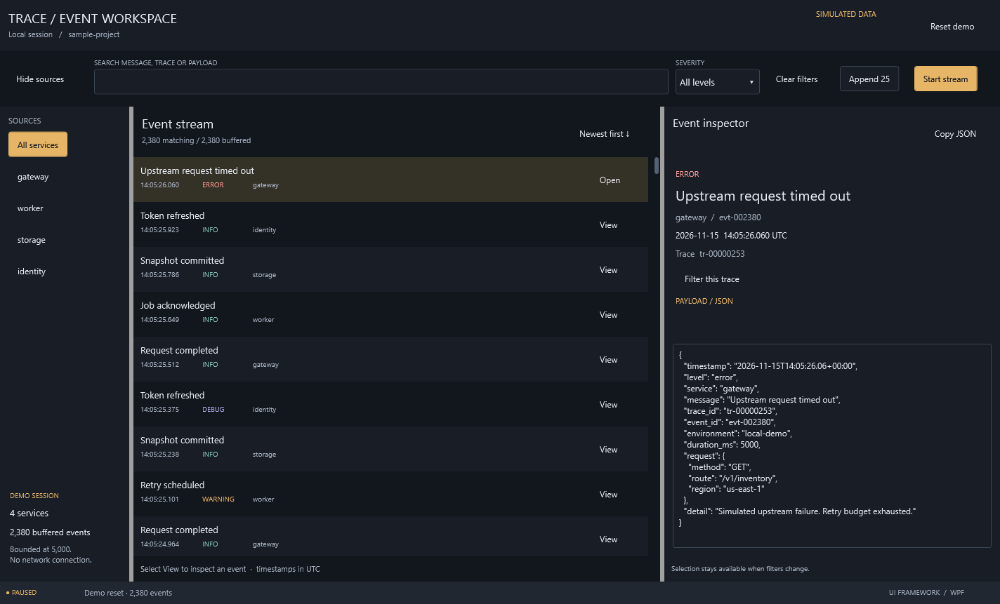
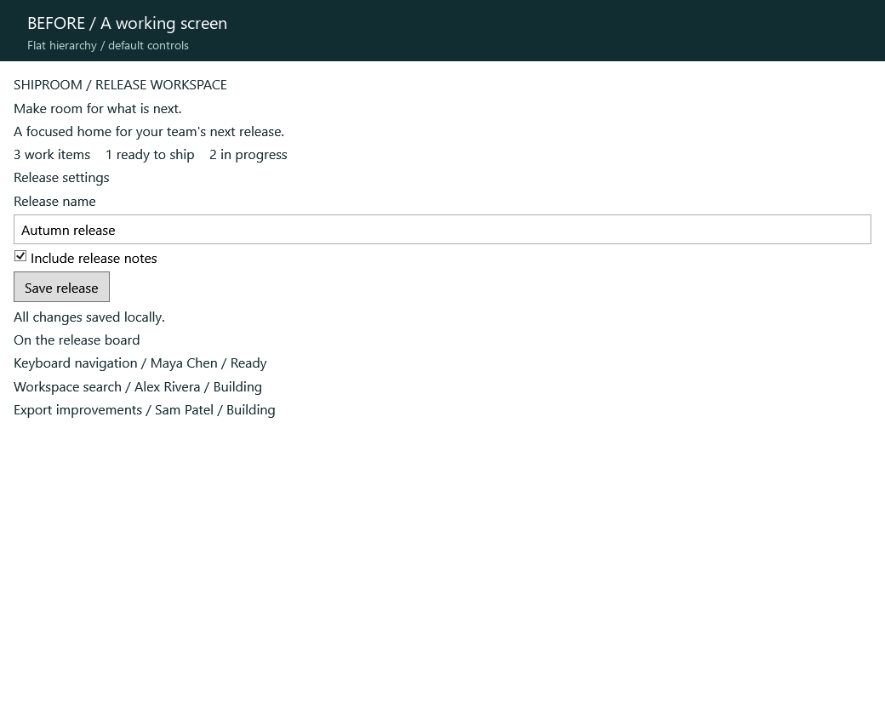

# ui-framework

[Source repository](https://github.com/signalnotnoise/ui-framework)

**1.3.0 · Windows renderer · .NET 10**

V1 preserves the supported source, binary and behavioral contracts within the major version; see the [API contract](docs/api-contract.md). Licensed under [MIT](LICENSE). Version 1.3.0 adds independent button tooltips and compact icon-button styling guidance. Publication is pending validation; see the [1.3.0 release status](docs/releases/1.3.0.md), [release checklist](docs/releasing.md), and [changelog](CHANGELOG.md).

A small SwiftUI-inspired C# UI framework. The core is a .NET class library; the first backend renders WPF controls on Windows. The runtime requires no XAML or third-party packages. Tests use MSTest.

See the [documentation index](docs/README.md) for API guides, architectural decisions, benchmarks, and the next milestone.

## Run Trace, the desktop log viewer

Trace demonstrates resizable panes, keyed virtual rows, live filtering and a
retained JSON inspector using native WPF controls. All events are simulated;
it does not connect to a server or read your logs.

[](docs/images/trace-walkthrough.mp4)

**[Watch or download the 30-second walkthrough (MP4)](docs/images/trace-walkthrough.mp4)** —
live ingestion, search, event selection, pause and Copy JSON. Silent recording
of the running app; not a performance measurement.

Requires **Windows and a stable .NET 10 SDK**. Clone or download this repository,
open a terminal in its root directory, then run:

```powershell
dotnet run --project samples/LogViewer -c Release
```

The command restores and builds the sample and its project-referenced libraries.
An installed .NET 11 preview alone does not satisfy `global.json`.
[Demo controls, ownership and verification](samples/LogViewer/README.md).

Building with an AI coding tool? [Install the UI Framework skill](docs/agent-skill.md#install-and-invoke)
or [read its rules and linked API reference](skills/ui-framework/SKILL.md).

## NuGet

Version `1.2.0` adds [vector icons and icon buttons](docs/icons.md) and
[shared design-token scales](docs/design-tokens.md). See the [release record](docs/releases/1.2.0.md)
for publication status, exact source, hosted gates and installation verification.
Install [SignalNotNoise.UI.Wpf](https://www.nuget.org/packages/SignalNotNoise.UI.Wpf/1.2.0)
with its transitive [core package](https://www.nuget.org/packages/SignalNotNoise.UI/1.2.0):

```powershell
dotnet add package SignalNotNoise.UI.Wpf --version 1.2.0
```

The WPF package brings in the core automatically. See the
[package getting-started guide](docs/package-readme.md) and
[publishing instructions](docs/releasing.md). To validate local candidate packages,
run `./tools/Test-Packages.ps1`; outputs are under `artifacts/packages`.

## Run from source

Requires Windows and a stable .NET 10 SDK. `global.json` permits later stable
10.0 SDK feature bands; an installed .NET 11 preview alone does not satisfy it.
From this directory:

```powershell
dotnet build "UI Framework.slnx"
dotnet run --project samples/Counter
dotnet test "tests/UI Framework.Checks"
```

## Try the standalone package sample

`dotnet run --project samples/PackageWorkspace -c Release` opens the NuGet-only
workspace. Its [README](samples/PackageWorkspace/README.md) explains standalone
setup, editing, native ownership, shutdown and upgrade checks. This tests published
packages; the source examples below use project references.

## Try the release-planning showcase

Launchpad is a release-planning application with Overview, Board, and Details screens, retained state on Back, and reduced-motion-aware transitions. Move cards between Planned, Building, and Shipped, edit details, filter by title/owner/area, and add ideas while release metrics update.

```powershell
dotnet run --project samples/Counter -- --showcase
```

The demo uses session-only sample data. The existing stress lab remains the default. See [Launchpad](docs/launchpad.md) for a short walkthrough.

## Build with an agent

Use the [UI Framework skill](skills/ui-framework/SKILL.md) to help coding agents
build clean native C# interfaces with retained state, responsive layout and
scoped themes. [Install it and reproduce the before/after](docs/agent-skill.md).

In one controlled same-model, same-package coding task, the draft supplied with
the skill and references compiled and passed ten behavioral checks unchanged.
The draft without that context failed compilation and still failed after one
compiler-feedback correction. This is one constrained pilot, not a general
success-rate claim. [Method, results and limitations](docs/agent-skill.md#controlled-first-draft-pilot--november-19-2026-fw-034).



## Write a view

```csharp
using UI_Framework;
using UI_Framework.Wpf;
using static UI_Framework.UI;

var count = new State<int>(0);
var host = new ViewHost(() => VStack(
    Text($"Count: {count.Value}").FontSize(24),
    Button("Increment", () => count.Value++)
).Spacing(12).Padding(20));
```

Place the host in a WPF window and dispose it when the window closes. Create and access observable state on the UI thread. Reads during a build become subscriptions; conditional reads are tracked again each build. Multiple changes are batched through the dispatcher.

For a large initial tree, create the application's window handle before
constructing the host: `new WindowInteropHelper(window).EnsureHandle()`
(`System.Windows.Interop`). This lets WPF initialize its process DPI cache
before control creation. Configure the application's DPI policy first; keep
the window and shutdown lifetime application-owned. ViewHost does not create
an implicit window. See [startup measurements and rationale](docs/timing-bottleneck-2026-10-24.md).

Applications with substantial WPF text editing should create one
`WpfComCleanupPolicy` on the application STA before constructing controls, then
close it after disposing windows and native hosts but before dispatcher shutdown.
This replaces CLR eager COM cleanup with explicit idle cleanup on that STA; see
[the lifecycle guide](docs/application-cleanup-policy-2026-09-25.md).

## Reusable components

```csharp
public sealed class CounterView : Component
{
    private readonly State<int> count = new(0);

    public override View Body() => VStack(
        Text($"Count: {count.Value}"),
        Button("Increment", () => count.Value++)
    ).Spacing(12);

    public override void OnMounted() { /* Subscribe to external resources here. */ }
    public override void OnUnmounted() { /* Release those subscriptions here. */ }
}

// Use a descriptor so the renderer owns and retains the component instance.
var host = new ViewHost(() => Component<CounterView>().Id("counter"));
```

Keep local state in component fields. The renderer creates each component once for its type and identity. Local state changes rebuild that component's body without rebuilding its parent or unrelated siblings. Parent renders refresh descendants by default. Add `.Memo(immutableInputs)` to skip parent-driven rebuilds when those inputs compare equal; local observed-state updates still render. Include every changing prop and callback input in the comparison.

Pass props using `Component<MyView>(view => view.Title = title.Value)`. Configure runs before each body build on the retained instance, and its state reads are observed by that component. Use ordinary properties for props and reserve state fields for local state. Build/configure functions should describe views without changing observable state.

## Observable lists

```csharp
var rows = new StateList<string>(["a", "b"]);
var host = new ViewHost(() => VStack(
    rows.Select(id => Component<CounterView>().Id(id)).ToArray()
));
rows.Add("c");       // Automatically schedules an update.
rows.Move(0, 2);      // Retains keyed component state.
rows.Remove("b");    // Unmounts the removed component.
```

`StateList<T>` observes enumeration, indexing, and Count. Add, Remove, RemoveAt, Clear, Move, index replacement, and atomic ReplaceAll notify readers. Item property mutations are not deep-observed: use `State<T>` inside an item or replace the item. State rejects access from other threads before a mutation occurs; marshal background results through WPF's dispatcher.

## Data binding and stress app

`Binding<T>` lets a child read and edit parent-owned data. `state.Binding()` connects directly; `state.Binding(get, set)` projects into a record, and `.Select(get, set)` composes deeper projections using the latest parent value. TextField and Toggle accept bindings, synchronize shared editors, and read back normalized/rejected edits without event feedback. See [binding contracts and examples](docs/bindings.md).

Bindings now notify their readers only when the projected value changes. `State.Select(get)` creates a read-only selector; `new Computed<T>(() => ...)` observes a derived value across multiple sources and dynamic branches. Derived subscriptions attach only while observed and detach with the final reader. See [rendering performance contracts](docs/performance.md).

The [first measured optimization pass](docs/performance-results.md) reduced body builds and allocations; the matched 50-operation comparison improved elapsed time by about 10%. Large native lists remain a performance limit.

The Counter app is now a [binding stress lab](docs/stress-lab.md): a project board with up to 1,000 rows, full-list and [virtualized modes](docs/virtualization.md), a shared inspector, nested checklists, filters, project settings, lifecycle/heap counters, recursive components, a 10,000-write burst, and a stoppable mixed-operation campaign. Run it normally for manual testing, or use the documented `--stress` mode to generate measurements and an offscreen dashboard capture.

Additional primitives include `Toggle`, `Scroll`, Width/Height, Background/Foreground, and CornerRadius. `FlexRow`, `AdaptiveGrid`, and `Align` add responsive layout; `ThemeTokens` and scoped WPF `ThemeStyles` provide reusable button and input styling with interaction states. See [layout and styling](docs/layout-styling.md).

## Projects

- `UI Framework`: view descriptions, components, observable values/lists, bindings, dependency tracking.
- `UI Framework.Wpf`: native controls, scheduling, reconciliation, component lifetime.
- `samples/Counter`: project-workspace stress app and repeatable automated stress workload.
- `tests/UI Framework.Checks`: MSTest regression tests with STA execution for WPF, discoverable in Test Explorer.
- `docs/knowledge-graph.json`: maintained architecture nodes, relationships, status, and source evidence.
- `docs/knowledge-graph.md`: generated Mermaid map and source index.
- `docs/components.md`: component identity, lifecycle, and scheduling contracts.

Use `.Id(stableKey)` for dynamic siblings. Keys must be unique within a parent. Unkeyed children use their position as identity; changing kind, component type, or key replaces the instance. Removal releases the component; adding the same key later starts fresh state. Matching controls are updated in place. Spacing separates children; padding is inside a view's border.

## Knowledge graph

Open [the architecture map](docs/knowledge-graph.md). It connects APIs, state observation, rendering, tests, and outstanding limitations. It is a maintained design graph, not an automatic runtime trace or a vector database. Edit the JSON when architecture changes, then regenerate and validate:

```powershell
powershell -NoProfile -File tools/Update-KnowledgeGraph.ps1
powershell -NoProfile -File tools/Update-KnowledgeGraph.ps1 -Check
```

## Prototype limits

This is an initial working foundation, not a production SwiftUI replacement.

| Area | Current behavior |
| --- | --- |
| Component state | Retained per type and sibling identity; released on removal. |
| Lifecycle | Mount/unmount hooks; subtree subscriptions detach before cleanup hooks run. |
| Update scope | Local updates skip ancestors/siblings; explicit Memo inputs let unchanged child components skip parent-driven rebuilds. |
| Mutable collections | Structural changes observed through StateList; arbitrary object mutations are not deep-observed. |
| Binding | Direct/composed projections notify only when the selected value changes; raw State.Value reads still observe the whole state. |
| Styling | Theme tokens, scoped button/input styles, weighted rows, adaptive columns, alignment, and entry transitions; no general animation API. |
| Threading | State belongs to its creating thread; no concurrent state or automatic marshaling. |
| Focus | Tested selection restoration, actual row recycling and rejection of stale input; active native composition uses WPF's focus-loss path before detachment. Physical IME acceptance remains pending. See [editing policy](docs/virtualization.md). |
| Accessibility | Explicit native names and patterns. Logical row peers support offscreen name discovery and realization. Narrator and physical scaling were reported passing; manual contrast acceptance remains open. See [acceptance](docs/accessibility-2026-10-26.md). |
| Errors | Failed builds preserve the previous tree; patch failures clear the affected host and allow explicit rebuild. See [failure and recovery contracts](docs/error-recovery.md). No rollback of application side effects or built-in recovery UI. |
| Virtualization | Viewport controls plus a buffer; offscreen logical state retained; some large shuffles have quadratic cost. See [contracts](docs/virtualization.md). |
| Navigation | Typed history, Back/PopToRoot/Reset, logical screen snapshots, and WPF entry transitions. See [navigation](docs/navigation.md). |
| Still planned | General animation, advanced styling, hot reload integration, and non-Windows backends. |

For a demo already running in Debug, stop it before rebuilding, or use `dotnet run --project samples/Counter -c Release` to build and run separately.

### Interactive repository map

Open the [offline interactive graph](docs/knowledge-graph/graph.html), or see its
[JSON data](docs/knowledge-graph/graph.json) and [generation guide](docs/knowledge-graph/README.md).
It combines the preserved curated architecture with schema-v2 file membership,
evidenced Markdown/import links and explicit .NET project references. C# calls
and using directives are not resolved.

For visual Git correlation, run
`python scripts/export-knowledge-graph-history.py --worktree --force` and open
`artifacts/knowledge-graph-history/graph.html`. Select files/concepts to see their
recent commits, click commits to highlight changes, or compare two revisions.
See [history views and export limits](docs/knowledge-graph/README.md#visual-git-history).

Use bounded queries while working; history defaults to committed HEAD:

```sh
python scripts/query-knowledge-graph.py locate native --at worktree --limit 20
python scripts/query-knowledge-graph.py neighbors concept:wpfstartup --at worktree --limit 15
python scripts/query-knowledge-graph.py history "UI Framework.Wpf/ViewHost.cs" --limit 10
```

Python 3.10+ and Git are required. With this repository's existing standalone
hook, enable automatic graph updates once per clone:

```sh
git config --local core.hooksPath .githooks
```

The hook protects unstaged/untracked/deleted generated output, reads staged
inputs with a matching extractor, and stages only the two interactive outputs.
For an unstaged preview, run `python scripts/update-knowledge-graph.py --worktree`;
validate it with the same command plus `--check`. CI checks committed outputs.
The existing curated JSON and PowerShell/Mermaid workflow remain authoritative
for architecture descriptions. See the generation guide before installing over
an existing hook configuration.
