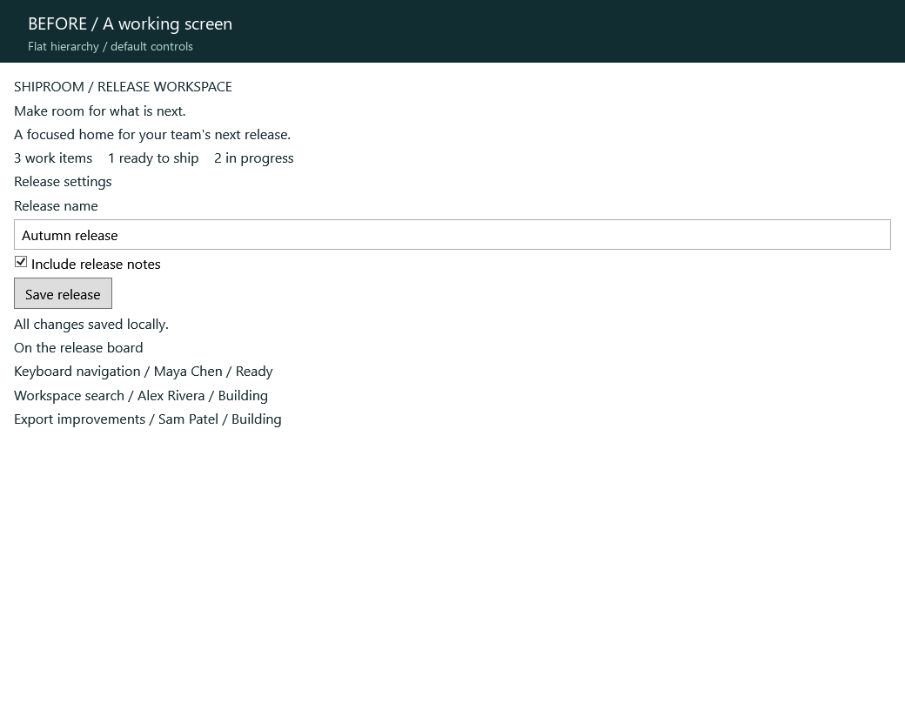

# Build native C# UIs with an agent

The [ui-framework skill](../skills/ui-framework/SKILL.md) teaches coding agents
how to compose this kit's actual APIs into clean native interfaces: visual
hierarchy, finite responsive layout, scoped themes, retained component state,
bindings and application-owned WPF lifetime. It is portable Markdown with a
small [composition recipe](../skills/ui-framework/references/composition.md).

## Install and invoke

Copy the `skills/ui-framework` folder into your agent's skill directory.
For Codex on Windows, run from this checkout (use your configured skills path
if you have customized it):

```powershell
Copy-Item -Recurse skills/ui-framework "$HOME/.codex/skills/ui-framework"
```

If that destination already exists, review and merge it instead of overwriting
local changes. Start a new agent session if it does not discover newly installed
skills. Example prompt:

> Use $ui-framework to refine my release workspace. Preserve the existing data
> and actions, use the installed package APIs, and verify wide and narrow layouts.

The optional `agents/openai.yaml` supplies discovery metadata. Other agents can
read `SKILL.md` directly. The skill does not install or upgrade the framework;
the consumer's resolved version governs API availability.

## Generated contract and behavioral examples

The portable bundle includes a version-labelled [shipped API reference](../skills/ui-framework/references/api-surface.md)
generated from both libraries' `PublicAPI.Shipped.txt` files. Exact analyzer
notation preserves nullability and overloads. Unshipped additions are excluded;
the consumer's installed version remains authoritative. Inherited and
compiler-generated members may require assembly inspection.

[Behavioral examples](../skills/ui-framework/references/behavior-examples.md)
are generated from complete C# types in `tests/UI Framework.Checks/SkillExamples`.
Edit those sources, then regenerate; do not maintain a second copy of their code.
`SkillContractTests` verifies finite native layout, stack sizing, retained state
notifications and keyed virtual row edits across reorder/removal. These focused
checks do not replace broader virtualization or accessibility acceptance.

```powershell
python tools/Update-SkillReference.py
python tools/Update-SkillReference.py --check
python scripts/test-skill-reference.py
dotnet test 'tests/UI Framework.Checks/UI Framework.Checks.csproj' -c Release --filter FullyQualifiedName~SkillContractTests
```

CI and `tools/Test-Release.ps1` reject stale references; release validation
also runs the compiled examples as part of the existing regression suite.
Python 3.10+ is required alongside the pinned .NET SDK. When cutting a release,
review/promote the API baselines and package version before regenerating the
reference. This documents declarations, not compatibility across every version.

### Phase 1 verification — November 15, 2026 (FW-030)

SDK 10.0.402 compiled the example types. All 34 selected tests passed:
`SkillContractTests`, `StateSessionTests`, `WorkspaceLayoutTests` and
`VirtualizationTests`. The three Python generator tests passed, including
missing/stale output rejection and exact signature/source preservation.
The initial state test incorrectly expected one invalidation while observing
both a field and its computed value; it was corrected to verify stable counts
for both dependencies, computed equality suppression and disposal cleanup.
Initial and final TRX reports remain in `artifacts/skill-contract`.

Reference freshness, documentation consistency and both graph validators pass.
No runtime, renderer, theme or benchmark code changed, so performance was not
remeasured.

Full local `tools/Test-Release.ps1` validation subsequently passed with SDK
10.0.402: warning-free Release build, 180/180 regression tests, reporting
retention controls, 15 visual checks, 21 stress assertions, actual-window
startup/editing/disposal, native-window ownership/shutdown and the short memory
check (76 native mounts, zero surviving instances and zero owned native bytes).
No release-validation failures required fixes. The transcript is retained at
`artifacts/phase1-release/full-release.log`; test/stress/native reports are in
`artifacts/release-validation`. Hosted CI is checked separately after pushing
the exact commit; local success does not establish the hosted performance gate.

## Before and after



These are actual offscreen WPF renders, composed in C# with the source kit.
Both wide frames use the same 1040 by 760 DIP viewport, 96 DPI, field values,
three work items and save action. The 72-pixel caption strip is presentation
chrome. The loop holds Before for 2.4 seconds and After for 4.2 seconds. It is
an authored demonstration of the skill's guidance, not a controlled agent
benchmark, a recording of interaction, or an animation feature of the framework.

The [capture fixture](../tools/SkillPreview/ReleaseScreen.cs) contains both
compositions. The save action updates session-only feedback; no backend is
implied. At 640 DIP the polished workspace stacks its settings and board panels
and grows to 898 DIP; a real application should provide scrolling when its
window is shorter. [Narrow native render](images/ui-framework-after-narrow.png).

## Reproduce

On Windows with the repository's compatible .NET 10 SDK and Python with Pillow:

```powershell
dotnet run --project tools/SkillPreview -c Release
python tools/New-SkillPreviewGif.py
```

The capture tool writes four PNGs to `artifacts/skill-preview`; the GIF encoder
checks matching wide dimensions, frame count, loop setting and durations. It
adds labels and encodes the captures without synthesizing interface pixels.
It uses Windows' Segoe UI font. Offscreen rendering does not take over the desktop.

## Verification — November 13, 2026

- Release fixture build and four native captures succeeded using local SDK
  10.0.402. The system SDK was 11 preview and could not satisfy `global.json`;
  the SDK pin was preserved. An isolated 10.0.404 install is also available
  under ignored artifacts, but was not used for the successful captures.
- Inspected Before and After at 1040 DIP and After at 640 DIP: readable fields,
  complete content and expected two-column to one-column reflow.
- Skill frontmatter/scaffold validation and GIF frame/timing checks passed.
- Curated and generated knowledge graph checks and documentation consistency
  checks passed. Completion evidence is recorded under FW-023 in the backlog.

No core, renderer, control template or benchmark implementation changed. This
instruction/media fixture establishes no new performance or release claim.
Keyboard navigation, physical IME, UI Automation and contrast-mode interaction
were not exercised in this capture task; the GIF is not acceptance evidence
for those behaviors. No package publication is part of this work.
