# UI Framework knowledge graph

Generated from knowledge-graph.json. Edit that file and run tools/Update-KnowledgeGraph.ps1. This is a maintained architecture graph; planned nodes describe future work, not implemented APIs.

Green: implemented. Amber: partial. Gray: planned.

```mermaid
flowchart LR
  subgraph implemented[implemented]
    accessibility["UI Automation and accessibility acceptance"]
    nativeinterop["Retained native WPF islands"]
    editors["Text editors, passwords and selectors"]
    layoutstyle["Responsive layout and scoped styling"]
    launchpad["Launchpad product showcase"]
    api["C# composition API"]
    view["View description"]
    component["Reusable component"]
    state["Observable state"]
    list["Observable list"]
    session["Dependency session"]
    host["WPF view host"]
    dispatcher["Batched dispatcher"]
    identity["Sibling identity"]
    lifecycle["Mount and cleanup"]
    controls["Native WPF controls"]
    checks["Regression checks"]
    demo["Component demo"]
    focus["Focus and IME"]
    navigation["Navigation"]
    binding["Live data binding"]
    stress["Stress workload"]
    derived["Derived observation"]
    memo["Component input comparison"]
    visualstress["Visible stress sequence"]
    release["Version 1 publication and verification"]
    wpfstartup["Application-owned WPF presentation startup"]
    graphnavigation["Revision-aware repository navigation"]
    agentskill["Agent UI composition skill"]
    measurementreporting["Memory measurement and attribution"]
    logviewer["Trace log viewer showcase"]
  end
  subgraph partial[partial]
    updates["Fine-grained updates"]
    errors["Error recovery"]
    styling["Styling and themes"]
    virtualization["List virtualization"]
    animation["Animation"]
  end
  subgraph planned[planned]
    hotreload["Hot reload tooling"]
    platforms["Other backends"]
  end
  accessibility -->|verifies native patterns and logical row discovery for| virtualization
  accessibility -->|checks keyboard traversal and retained input identity through| focus
  accessibility -->|requires contrast and scaling acceptance for| styling
  host -->|retains and releases| nativeinterop
  api -->|exposes| editors
  editors -->|reads and writes through| binding
  host -->|renders native| editors
  api -->|creates| view
  api -->|describes| component
  component -->|owns local| state
  component -->|may own| list
  component -->|builds| view
  component -->|has independent| session
  session -->|observes reads of| state
  session -->|observes reads of| list
  session -->|invalidates| host
  host -->|schedules through| dispatcher
  dispatcher -->|coalesces| updates
  host -->|reconciles| view
  host -->|retains| controls
  host -->|matches using| identity
  identity -->|preserves| component
  host -->|manages| lifecycle
  lifecycle -->|detaches| session
  checks -->|verifies| identity
  checks -->|verifies| lifecycle
  checks -->|verifies local scope| updates
  checks -->|verifies mutations| list
  demo -->|exercises| component
  focus -->|needs visible checks on| controls
  errors -->|needs boundaries around| host
  styling -->|extends| view
  navigation -->|depends on| lifecycle
  virtualization -->|preserves keyed logical state and rejects stale input by| identity
  virtualization -->|consumes| list
  virtualization -->|owns row composition and restoration through| focus
  animation -->|extends| host
  hotreload -->|needs refresh integration with| host
  platforms -->|needs abstraction around| host
  binding -->|reads and writes| state
  component -->|accepts| binding
  controls -->|synchronizes through| binding
  checks -->|verifies| binding
  stress -->|exercises| demo
  stress -->|measures| updates
  stress -->|verifies balance of| lifecycle
  binding -->|filters changes through| derived
  derived -->|invalidates changed readers in| session
  host -->|compares child inputs using| memo
  memo -->|reduces| updates
  checks -->|verifies| derived
  checks -->|verifies| memo
  demo -->|exposes| visualstress
  visualstress -->|exercises| binding
  visualstress -->|exercises| identity
  release -->|validates| checks
  release -->|runs| stress
  launchpad -->|composes| api
  launchpad -->|edits through| binding
  launchpad -->|demonstrates| layoutstyle
  layoutstyle -->|extends| api
  launchpad -->|demonstrates| navigation
  navigation -->|uses| animation
  navigation -->|preserves state from| virtualization
  stress -->|measures native scope and lifetime work in| nativeinterop
  demo -->|owns| wpfstartup
  stress -->|measures| wpfstartup
  release -->|checks startup editing and disposal for| wpfstartup
  wpfstartup -->|avoids repeated platform discovery during construction of| controls
  graphnavigation -->|preserves curated evidence for| host
  release -->|checks deterministic navigation outputs through| graphnavigation
  nativeinterop -->|uses detach-before-release ownership from| lifecycle
  lifecycle -->|checks post-disposal collectability of visited native rows in| virtualization
  agentskill -->|teaches composition with| layoutstyle
  agentskill -->|preserves ownership of| host
  agentskill -->|documents application lifetime through| wpfstartup
  lifecycle -->|verified with samples from| measurementreporting
  measurementreporting -->|separates external automation peer roots from framework ownership during collection checks| accessibility
  agentskill -->|generates version-labelled declaration reference from| api
  agentskill -->|checks keyed row reorder and removal through| virtualization
  logviewer -->|composes finite docking and retained split panes with| layoutstyle
  logviewer -->|uses stable keyed rows from| virtualization
  logviewer -->|owns native presentation startup through| wpfstartup
  logviewer -->|demonstrates curated behavioral guidance from| agentskill
  animation -->|releases native clocks during| lifecycle
  animation -->|settles on native recycling in| virtualization
  animation -->|uses retained node identity from| identity
  agentskill -->|teaches version gated use of| animation
  classDef implemented fill:#dcfce7,stroke:#15803d,color:#14532d
  classDef partial fill:#fef3c7,stroke:#b45309,color:#78350f
  classDef planned fill:#f1f5f9,stroke:#64748b,color:#334155
  class accessibility,nativeinterop,editors,layoutstyle,launchpad,api,view,component,state,list,session,host,dispatcher,identity,lifecycle,controls,checks,demo,focus,navigation,binding,stress,derived,memo,visualstress,release,wpfstartup,graphnavigation,agentskill,measurementreporting,logviewer implemented
  class updates,errors,styling,virtualization,animation partial
  class hotreload,platforms planned
```

## Source index

| Concept | Status | Contract / limitation | Sources |
| --- | --- | --- | --- |
| UI Automation and accessibility acceptance | implemented | Core names and native peers support actionable patterns and virtual-row discovery; host wrappers skip Tab stops. WPF owns item discovery, realization and ordinary child enumeration. Scoped palettes follow contrast settings; TextBox uses frozen normal colors and conditional system resources. ThemeStyles batches resource publication with caller-aware initialization ownership. User-confirmed Narrator/scaling and October 29 physical contrast/IME acceptance closed FW-005/FW-006 within their recorded scope. The unreleased FW-018 cleanup uses weak row/peer registration, clears detached cached children and refreshes queried rows after layout without adding a field to every logical row or creating peers during ordinary cleanup. Three fresh-process runs retain zero editors through held row/list peers, one through a directly held editor peer, and zero after root release. All 176 framework tests pass, including four new cases covering collection, recycling/realization and removed-key reuse; all four fail with unchanged baseline libraries. Earlier premature-refresh and UIA-reentrancy prototypes failed and are preserved separately. Native release ownership remains balanced. Seven alternating pairs pass all 32 local checks against pre-change HEAD: allocations within 0.05%, unchanged component work and timing -3.79% to +4.91%, within unchanged budgets. No hosted release-gate claim. No new physical Narrator acceptance or sustained external-client budget is claimed. | [UI Framework/View.cs](../UI%20Framework/View.cs), [UI Framework.Wpf/ViewHost.cs](../UI%20Framework.Wpf/ViewHost.cs), [UI Framework.Wpf/Virtualization/VirtualListControl.cs](../UI%20Framework.Wpf/Virtualization/VirtualListControl.cs), [UI Framework.Wpf/Virtualization/VirtualListAutomationPeer.cs](../UI%20Framework.Wpf/Virtualization/VirtualListAutomationPeer.cs), [UI Framework.Wpf/Virtualization/VirtualRowAutomationPeer.cs](../UI%20Framework.Wpf/Virtualization/VirtualRowAutomationPeer.cs), [UI Framework.Wpf/Styling/ThemeStyles.cs](../UI%20Framework.Wpf/Styling/ThemeStyles.cs), [tests/UI Framework.Checks/AccessibilityTests.cs](../tests/UI%20Framework.Checks/AccessibilityTests.cs), [tests/UI Framework.Checks/AccessibilityAcceptanceTests.cs](../tests/UI%20Framework.Checks/AccessibilityAcceptanceTests.cs), [tools/AccessibilityAcceptance/Program.cs](../tools/AccessibilityAcceptance/Program.cs), [tools/AccessibilityAcceptance/AccessibilityAcceptance.csproj](../tools/AccessibilityAcceptance/AccessibilityAcceptance.csproj), [docs/accessibility.md](../docs/accessibility.md), [docs/accessibility-2026-10-26.md](../docs/accessibility-2026-10-26.md), [UI Framework.Wpf/Styling/ThemePalette.cs](../UI%20Framework.Wpf/Styling/ThemePalette.cs), [tests/UI Framework.Checks/ContrastThemeTests.cs](../tests/UI%20Framework.Checks/ContrastThemeTests.cs), [UI Framework.Wpf/Styling/ThemeColor.cs](../UI%20Framework.Wpf/Styling/ThemeColor.cs), [docs/accessibility-2026-10-28.md](../docs/accessibility-2026-10-28.md), [docs/contrast-allocation-investigation-2026-10-28.md](../docs/contrast-allocation-investigation-2026-10-28.md), [UI Framework.Wpf/Styling/TextBoxStyles.cs](../UI%20Framework.Wpf/Styling/TextBoxStyles.cs), [docs/textbox-contrast-2026-10-28.md](../docs/textbox-contrast-2026-10-28.md), [tests/UI Framework.Checks/ThemeResourceUpdateTests.cs](../tests/UI%20Framework.Checks/ThemeResourceUpdateTests.cs), [docs/theme-resource-batching-2026-10-28.md](../docs/theme-resource-batching-2026-10-28.md), [docs/discovery-initialization-2026-10-28.md](../docs/discovery-initialization-2026-10-28.md), [tests/UI Framework.Checks/TestAutomationTree.cs](../tests/UI%20Framework.Checks/TestAutomationTree.cs), [docs/manual-acceptance-2026-10-29.md](../docs/manual-acceptance-2026-10-29.md), [samples/NativeLifetime/AutomationRetentionProbe.cs](../samples/NativeLifetime/AutomationRetentionProbe.cs), [docs/fw018-automation-retention-2026-11-15.md](../docs/fw018-automation-retention-2026-11-15.md), [tests/UI Framework.Checks/AutomationLifetimeTests.cs](../tests/UI%20Framework.Checks/AutomationLifetimeTests.cs), [docs/fw018-peer-cache-cleanup-2026-11-15.md](../docs/fw018-peer-cache-cleanup-2026-11-15.md), [docs/verification-evidence/2026-11-15-peer-cache-cleanup/README.md](../docs/verification-evidence/2026-11-15-peer-cache-cleanup/README.md) |
| Retained native WPF islands | implemented | Core carries an opaque platform description. WPF Interop owns native factories, declared-type identity, updates, detachment, one-time release and an opt-in implicit-style boundary; applications own native contents, asynchronous provider work and durable state. FW-010 completed November 11, 2026 within the documented standard-WPF/WebView2 contract; existing callbacks suffice and no new runtime API is justified. Controlled ownership, partial-failure and late-completion checks, real-window shutdown, real-browser initialization/popup races, failure/recovery and script-close pass. Final interactive acceptance passes 9/9 fresh-process cases: keyboard traversal, three-theme identity/focus/text/selection, native/HTML trusted pointer, scrolling, sampled rectangular bounds, resize and verified HWND overlay limits. Retention passes six final runs: 270 parent/popup cycles including negative controls, 540 one-time releases, 1,350 captured process exits and 2,970 collected weak references. Timeout bounds the caller wait while retaining owner/dispatcher and one drain task; a permanently unsettled provider keeps close pending. Hard deadlines require app-owned process isolation; forced in-process disposal/cancellation is not promised. Arbitrary WPF clipping/sibling overlays, composition control, arbitrary websites/SSO and GuidedGrade adoption are outside this acceptance. Full Release validation passes 172 tests, 15 visual checks, 21 stress assertions and real-window startup/disposal. Raw source snapshots, pilot issues and per-case evidence are preserved. FW-018 retains representative memory budgets and diagnostics; no new performance-release claim. November 15 current status: FW-018 scoped lifetime/memory acceptance passes all 12 frozen-budget native/browser runs; additional contextual diagnostics and new physical Narrator revalidation are separate post-v1 FW-025/FW-026 by user decision. | [UI Framework/View.cs](../UI%20Framework/View.cs), [UI Framework/ViewKind.cs](../UI%20Framework/ViewKind.cs), [UI Framework.Wpf/Interop/WpfUI.cs](../UI%20Framework.Wpf/Interop/WpfUI.cs), [UI Framework.Wpf/Interop/NativeViewDescriptor.cs](../UI%20Framework.Wpf/Interop/NativeViewDescriptor.cs), [UI Framework.Wpf/Interop/NativeControlHost.cs](../UI%20Framework.Wpf/Interop/NativeControlHost.cs), [UI Framework.Wpf/Interop/NativeStyleScope.cs](../UI%20Framework.Wpf/Interop/NativeStyleScope.cs), [UI Framework.Wpf/Interop/NativeStyleResources.cs](../UI%20Framework.Wpf/Interop/NativeStyleResources.cs), [tests/UI Framework.Checks/NativeHostTests.cs](../tests/UI%20Framework.Checks/NativeHostTests.cs), [tests/UI Framework.Checks/NativeStyleTests.cs](../tests/UI%20Framework.Checks/NativeStyleTests.cs), [docs/native-interop.md](../docs/native-interop.md), [docs/native-style-validation.md](../docs/native-style-validation.md), [samples/Counter/Diagnostics/NativeStyleComparison.cs](../samples/Counter/Diagnostics/NativeStyleComparison.cs), [tools/Test-NativeStyleIsolation.ps1](../tools/Test-NativeStyleIsolation.ps1), [docs/native-island-performance.md](../docs/native-island-performance.md), [tests/UI Framework.Checks/NativeLifetime/NativeAsyncLifetimeTests.cs](../tests/UI%20Framework.Checks/NativeLifetime/NativeAsyncLifetimeTests.cs), [tests/UI Framework.Checks/NativeLifetime/HostCollectabilityTests.cs](../tests/UI%20Framework.Checks/NativeLifetime/HostCollectabilityTests.cs), [tests/UI Framework.Checks/NativeLifetime/AsyncNativeTestControl.cs](../tests/UI%20Framework.Checks/NativeLifetime/AsyncNativeTestControl.cs), [tests/UI Framework.Checks/NativeLifetime/NativeInitializationLease.cs](../tests/UI%20Framework.Checks/NativeLifetime/NativeInitializationLease.cs), [tests/UI Framework.Checks/NativeLifetime/SubscribedNativeTestControl.cs](../tests/UI%20Framework.Checks/NativeLifetime/SubscribedNativeTestControl.cs), [tests/UI Framework.Checks/NativeLifetime/DispatcherTaskPump.cs](../tests/UI%20Framework.Checks/NativeLifetime/DispatcherTaskPump.cs), [docs/native-lifetime-2026-10-29.md](../docs/native-lifetime-2026-10-29.md), [docs/verification-evidence/2026-10-29-native-lifetime/README.md](../docs/verification-evidence/2026-10-29-native-lifetime/README.md), [samples/NativeLifetime/NativeWindowSession.cs](../samples/NativeLifetime/NativeWindowSession.cs), [samples/NativeLifetime/LifetimeEditor.cs](../samples/NativeLifetime/LifetimeEditor.cs), [samples/NativeLifetime/WindowChecks.cs](../samples/NativeLifetime/WindowChecks.cs), [samples/NativeLifetime/MemoryWorkload.cs](../samples/NativeLifetime/MemoryWorkload.cs), [samples/NativeLifetime/RetentionWorkload.cs](../samples/NativeLifetime/RetentionWorkload.cs), [tools/Test-NativeLifetime.ps1](../tools/Test-NativeLifetime.ps1), [tools/Summarize-NativeMemory.py](../tools/Summarize-NativeMemory.py), [scripts/test-native-memory.py](../scripts/test-native-memory.py), [docs/native-window-memory-2026-10-29.md](../docs/native-window-memory-2026-10-29.md), [docs/webview2-review-2026-10-29.md](../docs/webview2-review-2026-10-29.md), [docs/webview2-review-source.json](../docs/webview2-review-source.json), [samples/WebViewAcceptance/BrowserSession.cs](../samples/WebViewAcceptance/BrowserSession.cs), [samples/WebViewAcceptance/AcceptanceSuite.cs](../samples/WebViewAcceptance/AcceptanceSuite.cs), [samples/WebViewAcceptance/Program.cs](../samples/WebViewAcceptance/Program.cs), [samples/WebViewAcceptance/Pages/parent.html](../samples/WebViewAcceptance/Pages/parent.html), [samples/WebViewAcceptance/Pages/child.html](../samples/WebViewAcceptance/Pages/child.html), [tools/Test-WebViewAcceptance.ps1](../tools/Test-WebViewAcceptance.ps1), [docs/webview2-acceptance-2026-10-29.md](../docs/webview2-acceptance-2026-10-29.md), [samples/WebViewAcceptance/README.md](../samples/WebViewAcceptance/README.md), [samples/WebViewAcceptance/InteractionChecks.cs](../samples/WebViewAcceptance/InteractionChecks.cs), [samples/WebViewAcceptance/InteractionWorkspace.cs](../samples/WebViewAcceptance/InteractionWorkspace.cs), [samples/WebViewAcceptance/KeyboardProbe.cs](../samples/WebViewAcceptance/KeyboardProbe.cs), [samples/WebViewAcceptance/KeyboardPacket.cs](../samples/WebViewAcceptance/KeyboardPacket.cs), [samples/WebViewAcceptance/ScreenProbe.cs](../samples/WebViewAcceptance/ScreenProbe.cs), [samples/WebViewAcceptance/Pages/interaction.html](../samples/WebViewAcceptance/Pages/interaction.html), [docs/webview2-interaction-2026-10-29.md](../docs/webview2-interaction-2026-10-29.md), [samples/WebViewAcceptance/FailureChecks.cs](../samples/WebViewAcceptance/FailureChecks.cs), [samples/WebViewAcceptance/ProcessFault.cs](../samples/WebViewAcceptance/ProcessFault.cs), [docs/webview2-recovery-2026-10-29.md](../docs/webview2-recovery-2026-10-29.md), [samples/WebViewAcceptance/ShutdownChecks.cs](../samples/WebViewAcceptance/ShutdownChecks.cs), [docs/webview2-shutdown-2026-11-11.md](../docs/webview2-shutdown-2026-11-11.md), [samples/WebViewAcceptance/RetentionChecks.cs](../samples/WebViewAcceptance/RetentionChecks.cs), [samples/WebViewAcceptance/RetentionCycle.cs](../samples/WebViewAcceptance/RetentionCycle.cs), [samples/WebViewAcceptance/RetentionTelemetry.cs](../samples/WebViewAcceptance/RetentionTelemetry.cs), [docs/webview2-retention-2026-11-11.md](../docs/webview2-retention-2026-11-11.md), [docs/native-provider-stall-policy.md](../docs/native-provider-stall-policy.md), [docs/webview2-final-2026-11-11.md](../docs/webview2-final-2026-11-11.md) |
| Text editors, passwords and selectors | implemented | Core describes bound multiline text, masked passwords and indexed pickers. WPF owns native editing, read-only selection, bounded undo, theme integration and feedback suppression. | [UI Framework/UI.cs](../UI%20Framework/UI.cs), [UI Framework/View.cs](../UI%20Framework/View.cs), [UI Framework/ViewKind.cs](../UI%20Framework/ViewKind.cs), [UI Framework.Wpf/Rendering/Node.cs](../UI%20Framework.Wpf/Rendering/Node.cs), [UI Framework.Wpf/ViewHost.cs](../UI%20Framework.Wpf/ViewHost.cs), [UI Framework.Wpf/Styling/ThemeStyles.cs](../UI%20Framework.Wpf/Styling/ThemeStyles.cs), [tests/UI Framework.Checks/EditorTests.cs](../tests/UI%20Framework.Checks/EditorTests.cs), [tests/UI Framework.Checks/CompactInputTests.cs](../tests/UI%20Framework.Checks/CompactInputTests.cs), [tests/UI Framework.Checks/PickerStyleTests.cs](../tests/UI%20Framework.Checks/PickerStyleTests.cs), [UI Framework.Wpf/Styling/PickerStyles.cs](../UI%20Framework.Wpf/Styling/PickerStyles.cs), [docs/editors.md](../docs/editors.md) |
| Responsive layout and scoped styling | implemented | Core defines weighted rows/columns, docking, split panes, adaptive grids, alignment and theme tokens. WPF owns measurement, native splitter input, templates and interaction states. Applications own native content, pane sizing and data templates. Scoped palette updates preserve controls; TextBox shares frozen normal brushes with conditional system-color triggers. Theme resource publication batches invalidations and respects caller-owned initialization. Latest paired validation passes 32/32 performance gates; remaining accessibility acceptance is tracked separately. FW-017 completes November 15 within scoped appearance acceptance. Existing implementation and manual evidence are credited. Eight hidden-HWND native captures are individually inspected across light/dark, wide/compact and normal/editor-focus states; form, compact toolbar, review list and split panes include long text, disabled action and textual errors. Focus state is injected for rendering, not a new physical keyboard claim. 222 fixture assertions and 44 focused styling/layout tests pass. The v1 validation contract is application-owned rules, timing, messages and accessible field context using existing APIs; no validation engine, error token, adorner or automatic announcement promise. Core/WPF source hashes remain unchanged; no new performance or hosted gate is claimed. Earlier FW-006 physical contrast/scaling evidence retains its missing build/scale metadata; FW-026 is a separate post-v1 Narrator follow-up. FW-038 adds unreleased immutable spacing, typography, radius and icon scales to ThemeTokens. Core owns reusable values and validation; composition explicitly selects roles, while WPF styles own scoped icon-label gap updates. Default appearance and explicit sizes remain unchanged. Default group instances are shared; nested record copies are isolated. Icon path coordinates remain geometry, not design tokens. FW-038 local verification passes 212 tests, including six token cases. Four default native previews are byte-identical and custom scales are inspected. All 24 seven-pair comparisons against the pre-token snapshot pass; allocation changes are at most +0.14%, with unchanged component work. No hosted gate or package publication is claimed. | [UI Framework/Layout/ViewAlignment.cs](../UI%20Framework/Layout/ViewAlignment.cs), [UI Framework/Styling/ThemeTokens.cs](../UI%20Framework/Styling/ThemeTokens.cs), [UI Framework/Styling/ButtonStyleKind.cs](../UI%20Framework/Styling/ButtonStyleKind.cs), [UI Framework.Wpf/Layout/AdaptivePanel.cs](../UI%20Framework.Wpf/Layout/AdaptivePanel.cs), [UI Framework/Layout/SplitAxis.cs](../UI%20Framework/Layout/SplitAxis.cs), [UI Framework/Layout/SplitPaneLayout.cs](../UI%20Framework/Layout/SplitPaneLayout.cs), [UI Framework.Wpf/Layout/FlexColumnPanel.cs](../UI%20Framework.Wpf/Layout/FlexColumnPanel.cs), [UI Framework.Wpf/Layout/SplitPanePanel.cs](../UI%20Framework.Wpf/Layout/SplitPanePanel.cs), [tests/UI Framework.Checks/WorkspaceLayoutTests.cs](../tests/UI%20Framework.Checks/WorkspaceLayoutTests.cs), [docs/workspace-layout.md](../docs/workspace-layout.md), [UI Framework.Wpf/Styling/ThemeStyles.cs](../UI%20Framework.Wpf/Styling/ThemeStyles.cs), [UI Framework.Wpf/Styling/ButtonContentPresenter.cs](../UI%20Framework.Wpf/Styling/ButtonContentPresenter.cs), [tests/UI Framework.Checks/CompactButtonTests.cs](../tests/UI%20Framework.Checks/CompactButtonTests.cs), [docs/compact-button-validation.md](../docs/compact-button-validation.md), [tests/UI Framework.Checks/ButtonContentTests.cs](../tests/UI%20Framework.Checks/ButtonContentTests.cs), [samples/Counter/Models/LaunchTheme.cs](../samples/Counter/Models/LaunchTheme.cs), [tests/UI Framework.Checks/LayoutStyleTests.cs](../tests/UI%20Framework.Checks/LayoutStyleTests.cs), [UI Framework.Wpf/Styling/ToggleStyles.cs](../UI%20Framework.Wpf/Styling/ToggleStyles.cs), [tests/UI Framework.Checks/ToggleStyleTests.cs](../tests/UI%20Framework.Checks/ToggleStyleTests.cs), [docs/layout-styling.md](../docs/layout-styling.md), [UI Framework.Wpf/Styling/ThemePalette.cs](../UI%20Framework.Wpf/Styling/ThemePalette.cs), [tests/UI Framework.Checks/ContrastThemeTests.cs](../tests/UI%20Framework.Checks/ContrastThemeTests.cs), [UI Framework.Wpf/Styling/ThemeColor.cs](../UI%20Framework.Wpf/Styling/ThemeColor.cs), [docs/accessibility-2026-10-28.md](../docs/accessibility-2026-10-28.md), [docs/contrast-allocation-investigation-2026-10-28.md](../docs/contrast-allocation-investigation-2026-10-28.md), [UI Framework.Wpf/Styling/TextBoxStyles.cs](../UI%20Framework.Wpf/Styling/TextBoxStyles.cs), [docs/textbox-contrast-2026-10-28.md](../docs/textbox-contrast-2026-10-28.md), [tests/UI Framework.Checks/ThemeResourceUpdateTests.cs](../tests/UI%20Framework.Checks/ThemeResourceUpdateTests.cs), [docs/theme-resource-batching-2026-10-28.md](../docs/theme-resource-batching-2026-10-28.md), [docs/fw017-evidence-review-2026-11-15.md](../docs/fw017-evidence-review-2026-11-15.md), [docs/manual-acceptance-2026-10-29.md](../docs/manual-acceptance-2026-10-29.md), [docs/agent-skill.md](../docs/agent-skill.md), [skills/ui-framework/SKILL.md](../skills/ui-framework/SKILL.md), [tools/SkillPreview/ReleaseScreen.cs](../tools/SkillPreview/ReleaseScreen.cs), [samples/Counter/VisualStressChecks.cs](../samples/Counter/VisualStressChecks.cs), [docs/fw017-appearance-acceptance-2026-11-15.md](../docs/fw017-appearance-acceptance-2026-11-15.md), [docs/verification-evidence/2026-11-15-appearance/README.md](../docs/verification-evidence/2026-11-15-appearance/README.md), [tools/SkillPreview/AppearanceScreen.cs](../tools/SkillPreview/AppearanceScreen.cs), [tools/SkillPreview/AppearanceAcceptance.cs](../tools/SkillPreview/AppearanceAcceptance.cs), [UI Framework/Styling/SpacingTokens.cs](../UI%20Framework/Styling/SpacingTokens.cs), [UI Framework/Styling/TypographyTokens.cs](../UI%20Framework/Styling/TypographyTokens.cs), [UI Framework/Styling/RadiusTokens.cs](../UI%20Framework/Styling/RadiusTokens.cs), [UI Framework/Styling/IconTokens.cs](../UI%20Framework/Styling/IconTokens.cs), [UI Framework.Wpf/Icons/IconButtonContent.cs](../UI%20Framework.Wpf/Icons/IconButtonContent.cs), [tests/UI Framework.Checks/DesignTokenTests.cs](../tests/UI%20Framework.Checks/DesignTokenTests.cs), [docs/design-tokens.md](../docs/design-tokens.md), [docs/performance-evidence/2026-11-20-design-tokens/README.md](../docs/performance-evidence/2026-11-20-design-tokens/README.md) |
| Launchpad product showcase | implemented | Session-only Overview, Board and Details screens with Back, retained local preferences, edits and workflow actions. Sample models own routes; WPF owns native screen lifetime. | [samples/Counter/Components/Launchpad.cs](../samples/Counter/Components/Launchpad.cs), [samples/Counter/Components/LaunchOverview.cs](../samples/Counter/Components/LaunchOverview.cs), [samples/Counter/Components/LaunchBoard.cs](../samples/Counter/Components/LaunchBoard.cs), [samples/Counter/Components/LaunchDetails.cs](../samples/Counter/Components/LaunchDetails.cs), [samples/Counter/Models/LaunchRoute.cs](../samples/Counter/Models/LaunchRoute.cs), [samples/Counter/Models/LaunchScreen.cs](../samples/Counter/Models/LaunchScreen.cs), [samples/Counter/Diagnostics/LaunchNavigationChecks.cs](../samples/Counter/Diagnostics/LaunchNavigationChecks.cs), [samples/Counter/Models/LaunchModel.cs](../samples/Counter/Models/LaunchModel.cs), [samples/Counter/Models/LaunchItem.cs](../samples/Counter/Models/LaunchItem.cs), [samples/Counter/Models/LaunchStage.cs](../samples/Counter/Models/LaunchStage.cs), [samples/Counter/LaunchpadWindow.cs](../samples/Counter/LaunchpadWindow.cs), [docs/launchpad.md](../docs/launchpad.md) |
| C# composition API | implemented | Text, Button, TextField, TextEditor, PasswordField, Picker, Toggle, Scroll, stacks, modifiers, and Component<T> factories. | [UI Framework/ViewKind.cs](../UI%20Framework/ViewKind.cs), [UI Framework/View.cs](../UI%20Framework/View.cs), [UI Framework/UI.cs](../UI%20Framework/UI.cs), [docs/api-contract.md](../docs/api-contract.md), [tools/Test-ApiCompatibility.ps1](../tools/Test-ApiCompatibility.ps1), [UI Framework/UI Framework.csproj](../UI%20Framework/UI%20Framework.csproj), [UI Framework.Wpf/UI Framework.Wpf.csproj](../UI%20Framework.Wpf/UI%20Framework.Wpf.csproj) |
| View description | implemented | Records describe a view tree without owning native controls. | [UI Framework/ViewKind.cs](../UI%20Framework/ViewKind.cs), [UI Framework/View.cs](../UI%20Framework/View.cs), [UI Framework/UI.cs](../UI%20Framework/UI.cs) |
| Reusable component | implemented | Retained instance with Body, local state, props, and lifetime hooks. | [UI Framework/Component.cs](../UI%20Framework/Component.cs), [docs/components.md](../docs/components.md) |
| Observable state | implemented | Tracks value reads and notifies on unequal assignments. Notifications verify thread ownership and finish delivering to all observers before propagating errors. | [UI Framework/IState.cs](../UI%20Framework/IState.cs), [UI Framework/ObservableState.cs](../UI%20Framework/ObservableState.cs), [UI Framework/State.cs](../UI%20Framework/State.cs), [UI Framework/Dependencies.cs](../UI%20Framework/Dependencies.cs), [UI Framework/ViewSession.cs](../UI%20Framework/ViewSession.cs), [UI Framework/StateNotifications.cs](../UI%20Framework/StateNotifications.cs), [tests/UI Framework.Checks/StateNotificationTests.cs](../tests/UI%20Framework.Checks/StateNotificationTests.cs) |
| Observable list | implemented | Tracks collection reads and structural mutations, not arbitrary item properties. | [UI Framework/StateList.cs](../UI%20Framework/StateList.cs) |
| Dependency session | implemented | Each body/configure build records dependencies and removes stale subscriptions. | [UI Framework/IState.cs](../UI%20Framework/IState.cs), [UI Framework/ObservableState.cs](../UI%20Framework/ObservableState.cs), [UI Framework/State.cs](../UI%20Framework/State.cs), [UI Framework/Dependencies.cs](../UI%20Framework/Dependencies.cs), [UI Framework/ViewSession.cs](../UI%20Framework/ViewSession.cs) |
| WPF view host | implemented | Owns one render session and reconciles descriptions with retained controls. The lifetime wrapper is not a default focus or tab destination; actionable descendants own keyboard focus. Unchanged sibling order patches directly; keyed reconciliation moves a forward-displaced child once when its desired successor is adjacent, avoiding unnecessary detachments of intervening themed/native subtrees. | [UI Framework.Wpf/ViewHost.cs](../UI%20Framework.Wpf/ViewHost.cs), [UI Framework.Wpf/Rendering/Node.cs](../UI%20Framework.Wpf/Rendering/Node.cs), [tests/UI Framework.Checks/PanelReorderTests.cs](../tests/UI%20Framework.Checks/PanelReorderTests.cs), [docs/themed-reconciliation-2026-09-25.md](../docs/themed-reconciliation-2026-09-25.md) |
| Batched dispatcher | implemented | Coalesces invalidations into pending UI-thread renders. | [UI Framework.Wpf/ViewHost.cs](../UI%20Framework.Wpf/ViewHost.cs), [UI Framework.Wpf/Rendering/Node.cs](../UI%20Framework.Wpf/Rendering/Node.cs) |
| Sibling identity | implemented | Parent, key or position, kind, and component type determine reuse. | [UI Framework.Wpf/ViewHost.cs](../UI%20Framework.Wpf/ViewHost.cs), [UI Framework.Wpf/Rendering/Node.cs](../UI%20Framework.Wpf/Rendering/Node.cs), [docs/components.md](../docs/components.md) |
| Mount and cleanup | implemented | Subtree dependencies detach before unmount hooks; removed instances are released. FW-010 is complete within the November 11 native-provider contract: applications own async tasks, faults, cancellation and retained ownership across deadlines; late completion cannot attach to a closing owner, and cleanup drains before detachment/release. Permanently unsettled providers keep close pending; hard shutdown deadlines require app-owned process isolation. Controlled async/collectability and real-window shutdown checks pass; repeated WebView2 lifetime/recovery, script-close, final interactive and retention evidence is preserved. Browser retention covers 270 parent/popup pairs, 540 releases, 1,350 captured process exits and 2,970 collected references with deliberate-root negative controls. Earlier native-memory runs cover 756 workspace cycles and 57,456 native mounts with zero observed survivors/owned native bytes after batches. Visiting 500 keys retains 500 logical states but only 10 native editors; removal releases state. Heap/handle trends remain observations, not universal budgets. Full Release regression passes 172 tests, 15 visual checks and 21 stress assertions. FW-018 remains the first active P1 item for representative budgets and useful diagnostic API decisions. GuidedGrade application adoption remains separate. FW-018 resumed November 13: offline retention validation now checks report/workload identity, description counts, required probes, logical/native payload accounting, coarse native realization bounds and removed-state release. Focused corrupt-evidence fixtures and reanalysis of both archived three-run memory campaigns pass; only the longer campaign has retention checkpoints. That initial analyzer pass reused archived evidence; subsequent fresh reporting-isolation results are recorded below without approving a budget. Growing measurement-owned telemetry must be bounded before representative heap/handle budgets; contextual failure diagnostics and overhead measurements remain open. The sample-only release-reporting-roots-v1 probe now saves completed reporting samples, measures managed memory before/after clearing their roots and list capacity, checks weak-reference survivors, then reloads evidence after measurement. A deliberately rooted sample verifies sensitivity; empty controls expose GC noise. Three fresh 60-batch native runs each release 31,808 observed reporting bytes with zero sample survivors. Six corrected browser runs each release 38,016 bytes for fresh profiles or 25,344 for reused profiles, with all 44 roots collected. The failed pilot detects one reporting root; non-inlined sample construction resolves it. Original ownership/shutdown checks remain enabled. Signed deltas are not corrected workload trends or approved budgets; bounded reporting was the next step at that stage and is now implemented; budget calibration remains open. Final Release validation passes 172 tests, 15 visual checks, 21 stress assertions, reporting controls and real-window ownership/shutdown. The fresh-directory direct memory invocation passes. Failed and successful isolation sources/reports are hash-archived; both graphs are refreshed. No paired latency gate was rerun because framework runtime is unchanged. Final review also caught one surviving native sample in a one-batch pilot. Native sample construction is now non-inlined and both callers fail on reporting survivors. Final Release includes that short-run regression and passes; final three native soak runs release 31,808 / 31,832 / 31,808 bytes with zero roots. Two final browser guard cases pass with the previous per-mode deltas. Both failed pilots and final-source results are preserved separately. FW-018 bounded reporting now spools each sample to a fresh file with one pending weak probe, verifies prior sample collection before recording another, and reconstructs reports only after measurement. The bounded-sample-files-v1 protocol is distinct from retained-reporting evidence; controls, short native checks, three 60-batch native runs and six browser runs pass. All measured reporting roots collect and raw samples match reconstructed reports. Residual heap/handle trends remain unbudgeted. This changes sample tooling only, not framework runtime or accepted budgets. November 15 current status: FW-018 scoped lifetime/memory acceptance passes all 12 frozen-budget native/browser runs; additional contextual diagnostics and new physical Narrator revalidation are separate post-v1 FW-025/FW-026 by user decision. | [UI Framework/Component.cs](../UI%20Framework/Component.cs), [UI Framework.Wpf/ViewHost.cs](../UI%20Framework.Wpf/ViewHost.cs), [UI Framework.Wpf/Rendering/Node.cs](../UI%20Framework.Wpf/Rendering/Node.cs), [tests/UI Framework.Checks/NativeLifetime/NativeAsyncLifetimeTests.cs](../tests/UI%20Framework.Checks/NativeLifetime/NativeAsyncLifetimeTests.cs), [tests/UI Framework.Checks/NativeLifetime/HostCollectabilityTests.cs](../tests/UI%20Framework.Checks/NativeLifetime/HostCollectabilityTests.cs), [tests/UI Framework.Checks/NativeLifetime/AsyncNativeTestControl.cs](../tests/UI%20Framework.Checks/NativeLifetime/AsyncNativeTestControl.cs), [tests/UI Framework.Checks/NativeLifetime/NativeInitializationLease.cs](../tests/UI%20Framework.Checks/NativeLifetime/NativeInitializationLease.cs), [tests/UI Framework.Checks/NativeLifetime/SubscribedNativeTestControl.cs](../tests/UI%20Framework.Checks/NativeLifetime/SubscribedNativeTestControl.cs), [tests/UI Framework.Checks/NativeLifetime/DispatcherTaskPump.cs](../tests/UI%20Framework.Checks/NativeLifetime/DispatcherTaskPump.cs), [docs/native-lifetime-2026-10-29.md](../docs/native-lifetime-2026-10-29.md), [docs/verification-evidence/2026-10-29-native-lifetime/README.md](../docs/verification-evidence/2026-10-29-native-lifetime/README.md), [samples/NativeLifetime/NativeWindowSession.cs](../samples/NativeLifetime/NativeWindowSession.cs), [samples/NativeLifetime/LifetimeEditor.cs](../samples/NativeLifetime/LifetimeEditor.cs), [samples/NativeLifetime/WindowChecks.cs](../samples/NativeLifetime/WindowChecks.cs), [samples/NativeLifetime/MemoryWorkload.cs](../samples/NativeLifetime/MemoryWorkload.cs), [samples/NativeLifetime/RetentionWorkload.cs](../samples/NativeLifetime/RetentionWorkload.cs), [tools/Test-NativeLifetime.ps1](../tools/Test-NativeLifetime.ps1), [tools/Summarize-NativeMemory.py](../tools/Summarize-NativeMemory.py), [scripts/test-native-memory.py](../scripts/test-native-memory.py), [docs/native-window-memory-2026-10-29.md](../docs/native-window-memory-2026-10-29.md), [docs/webview2-review-2026-10-29.md](../docs/webview2-review-2026-10-29.md), [docs/webview2-review-source.json](../docs/webview2-review-source.json), [samples/WebViewAcceptance/FailureChecks.cs](../samples/WebViewAcceptance/FailureChecks.cs), [samples/WebViewAcceptance/ProcessFault.cs](../samples/WebViewAcceptance/ProcessFault.cs), [docs/webview2-recovery-2026-10-29.md](../docs/webview2-recovery-2026-10-29.md), [samples/WebViewAcceptance/ShutdownChecks.cs](../samples/WebViewAcceptance/ShutdownChecks.cs), [docs/webview2-shutdown-2026-11-11.md](../docs/webview2-shutdown-2026-11-11.md), [samples/WebViewAcceptance/RetentionChecks.cs](../samples/WebViewAcceptance/RetentionChecks.cs), [samples/WebViewAcceptance/RetentionCycle.cs](../samples/WebViewAcceptance/RetentionCycle.cs), [samples/WebViewAcceptance/RetentionTelemetry.cs](../samples/WebViewAcceptance/RetentionTelemetry.cs), [docs/webview2-retention-2026-11-11.md](../docs/webview2-retention-2026-11-11.md), [docs/native-provider-stall-policy.md](../docs/native-provider-stall-policy.md), [docs/webview2-final-2026-11-11.md](../docs/webview2-final-2026-11-11.md), [docs/fw018-memory-diagnostics-2026-11-13.md](../docs/fw018-memory-diagnostics-2026-11-13.md), [samples/MeasurementTools/ReportingRetention.cs](../samples/MeasurementTools/ReportingRetention.cs), [tests/ReportingRetentionChecks/Program.cs](../tests/ReportingRetentionChecks/Program.cs), [tests/ReportingRetentionChecks/ReportingRetentionChecks.csproj](../tests/ReportingRetentionChecks/ReportingRetentionChecks.csproj), [docs/fw018-reporting-retention-2026-11-13.md](../docs/fw018-reporting-retention-2026-11-13.md), [tools/Test-WebViewAcceptance.ps1](../tools/Test-WebViewAcceptance.ps1), [tools/Test-Release.ps1](../tools/Test-Release.ps1), [docs/verification-evidence/2026-11-13-reporting-retention/README.md](../docs/verification-evidence/2026-11-13-reporting-retention/README.md), [samples/MeasurementTools/BoundedReporting.cs](../samples/MeasurementTools/BoundedReporting.cs), [docs/fw018-bounded-reporting-2026-11-13.md](../docs/fw018-bounded-reporting-2026-11-13.md) |
| Native WPF controls | implemented | TextBlock, Button, TextBox, StackPanel, and Border provide Windows UI. | [UI Framework.Wpf/ViewHost.cs](../UI%20Framework.Wpf/ViewHost.cs), [UI Framework.Wpf/Rendering/Node.cs](../UI%20Framework.Wpf/Rendering/Node.cs) |
| Regression checks | implemented | Executable assertions for state, components, identity, lifecycle, and scheduling. | [tests/UI Framework.Checks/FrameworkTests.cs](../tests/UI%20Framework.Checks/FrameworkTests.cs), [tests/UI Framework.Checks/PrimitiveTests.cs](../tests/UI%20Framework.Checks/PrimitiveTests.cs), [tests/UI Framework.Checks/StateSessionTests.cs](../tests/UI%20Framework.Checks/StateSessionTests.cs), [tests/UI Framework.Checks/VirtualizationTests.cs](../tests/UI%20Framework.Checks/VirtualizationTests.cs), [tests/UI Framework.Checks/ComponentChecks.cs](../tests/UI%20Framework.Checks/ComponentChecks.cs), [tests/UI Framework.Checks/Probes/MountMutation.cs](../tests/UI%20Framework.Checks/Probes/MountMutation.cs), [tests/UI Framework.Checks/Probes/OtherProbe.cs](../tests/UI%20Framework.Checks/Probes/OtherProbe.cs), [tests/UI Framework.Checks/Probes/Probe.cs](../tests/UI%20Framework.Checks/Probes/Probe.cs), [tests/UI Framework.Checks/BindingChecks.cs](../tests/UI%20Framework.Checks/BindingChecks.cs), [tests/UI Framework.Checks/Probes/Profile.cs](../tests/UI%20Framework.Checks/Probes/Profile.cs), [tests/UI Framework.Checks/Probes/Preferences.cs](../tests/UI%20Framework.Checks/Probes/Preferences.cs), [tests/UI Framework.Checks/OptimizationChecks.cs](../tests/UI%20Framework.Checks/OptimizationChecks.cs), [tests/UI Framework.Checks/Probes/SelectionProbe.cs](../tests/UI%20Framework.Checks/Probes/SelectionProbe.cs), [tests/UI Framework.Checks/Probes/CallbackProbe.cs](../tests/UI%20Framework.Checks/Probes/CallbackProbe.cs), [tests/UI Framework.Checks/Probes/MemoProbe.cs](../tests/UI%20Framework.Checks/Probes/MemoProbe.cs), [tests/UI Framework.Checks/Probes/Pair.cs](../tests/UI%20Framework.Checks/Probes/Pair.cs) |
| Component demo | implemented | Project board with shared editors, nested checklists, filters, preferences, telemetry, and recursive components. | [samples/Counter/Program.cs](../samples/Counter/Program.cs), [samples/Counter/Components/LabComponent.cs](../samples/Counter/Components/LabComponent.cs), [samples/Counter/Components/Dashboard.cs](../samples/Counter/Components/Dashboard.cs), [samples/Counter/Components/CommandBar.cs](../samples/Counter/Components/CommandBar.cs), [samples/Counter/Components/VisualStressPanel.cs](../samples/Counter/Components/VisualStressPanel.cs), [samples/Counter/Components/SummaryPanel.cs](../samples/Counter/Components/SummaryPanel.cs), [samples/Counter/Components/FilterPanel.cs](../samples/Counter/Components/FilterPanel.cs), [samples/Counter/Components/BoardSlot.cs](../samples/Counter/Components/BoardSlot.cs), [samples/Counter/Components/WorkList.cs](../samples/Counter/Components/WorkList.cs), [samples/Counter/Components/WorkRow.cs](../samples/Counter/Components/WorkRow.cs), [samples/Counter/Components/Inspector.cs](../samples/Counter/Components/Inspector.cs), [samples/Counter/Components/ItemEditor.cs](../samples/Counter/Components/ItemEditor.cs), [samples/Counter/Components/ChecklistPanel.cs](../samples/Counter/Components/ChecklistPanel.cs), [samples/Counter/Components/ChecklistRow.cs](../samples/Counter/Components/ChecklistRow.cs), [samples/Counter/Components/ProjectPanel.cs](../samples/Counter/Components/ProjectPanel.cs), [samples/Counter/Components/TelemetryPanel.cs](../samples/Counter/Components/TelemetryPanel.cs), [samples/Counter/Components/DepthPanel.cs](../samples/Counter/Components/DepthPanel.cs), [samples/Counter/Components/DepthNode.cs](../samples/Counter/Components/DepthNode.cs), [samples/Counter/Components/ActivityPanel.cs](../samples/Counter/Components/ActivityPanel.cs), [samples/Counter/Models/Preferences.cs](../samples/Counter/Models/Preferences.cs), [samples/Counter/Models/ProjectSettings.cs](../samples/Counter/Models/ProjectSettings.cs), [samples/Counter/Models/WorkDetails.cs](../samples/Counter/Models/WorkDetails.cs), [samples/Counter/Models/WorkData.cs](../samples/Counter/Models/WorkData.cs), [samples/Counter/Models/StepData.cs](../samples/Counter/Models/StepData.cs), [samples/Counter/Models/VisualStressState.cs](../samples/Counter/Models/VisualStressState.cs), [samples/Counter/Models/ChecklistItem.cs](../samples/Counter/Models/ChecklistItem.cs), [samples/Counter/Models/WorkItem.cs](../samples/Counter/Models/WorkItem.cs), [samples/Counter/Models/Counters.cs](../samples/Counter/Models/Counters.cs), [samples/Counter/Models/WorkspaceModel.cs](../samples/Counter/Models/WorkspaceModel.cs) |
| Fine-grained updates | partial | Projected observation, local scheduling, and opt-in Memo reduce rebuilds; genuinely broad changes and native layout remain expensive. | [docs/performance.md](../docs/performance.md), [UI Framework/Computed.cs](../UI%20Framework/Computed.cs), [UI Framework.Wpf/ViewHost.cs](../UI%20Framework.Wpf/ViewHost.cs), [UI Framework.Wpf/Rendering/Node.cs](../UI%20Framework.Wpf/Rendering/Node.cs) |
| Focus and IME | implemented | The nearest WPF row tracks composition by editor source, since native phase objects change. Focus departure lets WPF finalize native TSF/IMM before detachment; generic providers retain a fallback. Nested editors deactivate before final snapshots. Weak original-focus identity respects newer focus. Routed/native-shape tests and a delayed-action window provide partial evidence; user-confirmed physical IME and Windows contrast acceptance closes FW-005/FW-006 on October 29; exact provider/build and logs were not supplied. Guarded forward moves require no presenter or descendant composition, focus, mouse capture, pending restoration or completion failure; the check does not change composition ownership. | [README.md](../README.md), [tests/UI Framework.Checks/ComponentChecks.cs](../tests/UI%20Framework.Checks/ComponentChecks.cs), [tests/UI Framework.Checks/Probes/MountMutation.cs](../tests/UI%20Framework.Checks/Probes/MountMutation.cs), [tests/UI Framework.Checks/Probes/OtherProbe.cs](../tests/UI%20Framework.Checks/Probes/OtherProbe.cs), [tests/UI Framework.Checks/Probes/Probe.cs](../tests/UI%20Framework.Checks/Probes/Probe.cs), [UI Framework.Wpf/Virtualization/RowFocusSnapshot.cs](../UI%20Framework.Wpf/Virtualization/RowFocusSnapshot.cs), [tests/UI Framework.Checks/VirtualizationTests.cs](../tests/UI%20Framework.Checks/VirtualizationTests.cs), [UI Framework.Wpf/Rendering/FocusIdentity.cs](../UI%20Framework.Wpf/Rendering/FocusIdentity.cs), [UI Framework.Wpf/Virtualization/VirtualRowPresenter.cs](../UI%20Framework.Wpf/Virtualization/VirtualRowPresenter.cs), [tests/UI Framework.Checks/VirtualizedEditingTests.cs](../tests/UI%20Framework.Checks/VirtualizedEditingTests.cs), [tests/UI Framework.Checks/Probes/TrackedTextComposition.cs](../tests/UI%20Framework.Checks/Probes/TrackedTextComposition.cs), [tools/VirtualizedEditingAcceptance/Program.cs](../tools/VirtualizedEditingAcceptance/Program.cs), [tools/VirtualizedEditingAcceptance/VirtualizedEditingAcceptance.csproj](../tools/VirtualizedEditingAcceptance/VirtualizedEditingAcceptance.csproj), [docs/virtualization.md](../docs/virtualization.md), [docs/virtualized-editing-2026-10-24.md](../docs/virtualized-editing-2026-10-24.md), [tests/UI Framework.Checks/GuardedMoveTests.cs](../tests/UI%20Framework.Checks/GuardedMoveTests.cs), [docs/manual-acceptance-2026-10-29.md](../docs/manual-acceptance-2026-10-29.md) |
| Error recovery | partial | Body and validation failures retain the last tree. Patch failures clear the affected host, finish cleanup and permit explicit rebuild; arbitrary application mutations cannot roll back. | [UI Framework/IState.cs](../UI%20Framework/IState.cs), [UI Framework/ObservableState.cs](../UI%20Framework/ObservableState.cs), [UI Framework/State.cs](../UI%20Framework/State.cs), [UI Framework/Dependencies.cs](../UI%20Framework/Dependencies.cs), [UI Framework/ViewSession.cs](../UI%20Framework/ViewSession.cs), [README.md](../README.md), [UI Framework.Wpf/ViewHost.cs](../UI%20Framework.Wpf/ViewHost.cs), [tests/UI Framework.Checks/RendererFailureTests.cs](../tests/UI%20Framework.Checks/RendererFailureTests.cs), [tests/UI Framework.Checks/ViewValidationTests.cs](../tests/UI%20Framework.Checks/ViewValidationTests.cs), [docs/error-recovery.md](../docs/error-recovery.md) |
| Styling and themes | partial | Basic dimensions, colors, corners, text size, spacing; advanced themes and style systems remain open. FW-037 adds unreleased immutable core VectorIcon definitions and Icon/Button/IconButton descriptions. WPF owns weak-key frozen geometry caching, viewport drawing, retained icon/label content and image automation peers; icon buttons remain native Buttons. Shared icon defaults are centralized; platform-only label spacing stays in the renderer. No SVG document parser or bundled third-party icon set. FW-037 verification: 206 tests including ten icon checks pass; wide/compact light/dark native captures inspected. All 24 seven-pair local comparisons pass, with unchanged component work and allocation changes up to +1.04%; small timing differences are inconclusive. Evidence measures ordinary-path overhead, not icon-heavy throughput or hosted release acceptance. | [UI Framework/ViewKind.cs](../UI%20Framework/ViewKind.cs), [UI Framework/View.cs](../UI%20Framework/View.cs), [UI Framework/UI.cs](../UI%20Framework/UI.cs), [UI Framework.Wpf/ViewHost.cs](../UI%20Framework.Wpf/ViewHost.cs), [UI Framework.Wpf/Rendering/Node.cs](../UI%20Framework.Wpf/Rendering/Node.cs), [README.md](../README.md), [UI Framework/Icons/VectorIcon.cs](../UI%20Framework/Icons/VectorIcon.cs), [UI Framework/Icons/IconDefaults.cs](../UI%20Framework/Icons/IconDefaults.cs), [UI Framework.Wpf/Icons/IconGeometry.cs](../UI%20Framework.Wpf/Icons/IconGeometry.cs), [UI Framework.Wpf/Icons/IconElement.cs](../UI%20Framework.Wpf/Icons/IconElement.cs), [UI Framework.Wpf/Icons/IconButtonContent.cs](../UI%20Framework.Wpf/Icons/IconButtonContent.cs), [UI Framework.Wpf/Icons/IconAutomationPeer.cs](../UI%20Framework.Wpf/Icons/IconAutomationPeer.cs), [tests/UI Framework.Checks/IconTests.cs](../tests/UI%20Framework.Checks/IconTests.cs), [docs/icons.md](../docs/icons.md), [docs/performance-evidence/2026-11-20-icons/README.md](../docs/performance-evidence/2026-11-20-icons/README.md) |
| Navigation | implemented | Core owns observable typed history and entry identity; WPF owns active-screen lifetime and logical snapshots, including nested navigation and virtual rows. | [UI Framework/Navigation/NavigationStack.cs](../UI%20Framework/Navigation/NavigationStack.cs), [UI Framework/Navigation/NavigationEntry.cs](../UI%20Framework/Navigation/NavigationEntry.cs), [UI Framework.Wpf/Navigation/NavigationSurface.cs](../UI%20Framework.Wpf/Navigation/NavigationSurface.cs), [UI Framework.Wpf/Navigation/NavigationSnapshot.cs](../UI%20Framework.Wpf/Navigation/NavigationSnapshot.cs), [UI Framework.Wpf/Rendering/NodeSnapshot.cs](../UI%20Framework.Wpf/Rendering/NodeSnapshot.cs), [UI Framework.Wpf/Virtualization/VirtualListSnapshot.cs](../UI%20Framework.Wpf/Virtualization/VirtualListSnapshot.cs), [tests/UI Framework.Checks/NavigationTests.cs](../tests/UI%20Framework.Checks/NavigationTests.cs), [docs/navigation.md](../docs/navigation.md) |
| List virtualization | partial | WPF owns logical ordering and realization; VirtualRowPresenter owns composition, focus and snapshots. VirtualRowCollection uses row-embedded AVL links, root-verified membership and a mutation-invalidated successor cursor. Removal/disposal sever links. Empty mounts omit the permutation buffer but retain per-row notifications; optional component/focus snapshots share sparse storage. Guarded moves preserve active-editor safeguards. FW-007 is complete locally: 159 tests, 15 visual checks, 21 stress assertions and actual-window validation pass. Seven-pair 10,000-row mounts save 680,216 bytes versus the guard and 22,416 versus phase one; large reorder gains remain. Broad alpha.6 comparison is 31/32 with editor mount +14.74%; a same-binary control and separate 8/8 editor confirmation preserve and contextualize that failure, not erase it. Mixed updates improve 51.04%, allocations 20.09%. Initial-Reset batching was rejected for first-update Gen 1 pauses. Source hashes and archived evidence are verified. Budgets and accepted revision are unchanged. User confirmed passing physical IME/contrast checks on October 29, closing FW-005/FW-006; exact provider/build and logs were not supplied. | [UI Framework.Wpf/Virtualization/VirtualListControl.cs](../UI%20Framework.Wpf/Virtualization/VirtualListControl.cs), [UI Framework.Wpf/Virtualization/VirtualListAutomationPeer.cs](../UI%20Framework.Wpf/Virtualization/VirtualListAutomationPeer.cs), [UI Framework.Wpf/Virtualization/VirtualRowAutomationPeer.cs](../UI%20Framework.Wpf/Virtualization/VirtualRowAutomationPeer.cs), [UI Framework.Wpf/Virtualization/VirtualRowPresenter.cs](../UI%20Framework.Wpf/Virtualization/VirtualRowPresenter.cs), [UI Framework.Wpf/Rendering/NodeSnapshot.cs](../UI%20Framework.Wpf/Rendering/NodeSnapshot.cs), [tests/UI Framework.Checks/VirtualizationTests.cs](../tests/UI%20Framework.Checks/VirtualizationTests.cs), [tests/UI Framework.Checks/AccessibilityAcceptanceTests.cs](../tests/UI%20Framework.Checks/AccessibilityAcceptanceTests.cs), [tests/UI Framework.Checks/VirtualizedEditingTests.cs](../tests/UI%20Framework.Checks/VirtualizedEditingTests.cs), [docs/virtualization.md](../docs/virtualization.md), [tools/KeyedShuffleDiagnostics/Program.cs](../tools/KeyedShuffleDiagnostics/Program.cs), [tests/UI Framework.Checks/KeyedReorderTests.cs](../tests/UI%20Framework.Checks/KeyedReorderTests.cs), [tools/Test-KeyedShuffles.ps1](../tools/Test-KeyedShuffles.ps1), [docs/fw007-keyed-shuffles-2026-10-28.md](../docs/fw007-keyed-shuffles-2026-10-28.md), [UI Framework.Wpf/Virtualization/VirtualRowCollection.cs](../UI%20Framework.Wpf/Virtualization/VirtualRowCollection.cs), [UI Framework.Wpf/Virtualization/VirtualRow.cs](../UI%20Framework.Wpf/Virtualization/VirtualRow.cs), [docs/fw007-indexed-shuffles-2026-10-28.md](../docs/fw007-indexed-shuffles-2026-10-28.md), [docs/performance-evidence/2026-10-28-indexed-shuffles/README.md](../docs/performance-evidence/2026-10-28-indexed-shuffles/README.md), [tests/UI Framework.Checks/GuardedMoveTests.cs](../tests/UI%20Framework.Checks/GuardedMoveTests.cs), [docs/fw007-guarded-move-2026-10-28.md](../docs/fw007-guarded-move-2026-10-28.md), [docs/performance-evidence/2026-10-28-guarded-move/README.md](../docs/performance-evidence/2026-10-28-guarded-move/README.md), [UI Framework.Wpf/Virtualization/VirtualRowSavedState.cs](../UI%20Framework.Wpf/Virtualization/VirtualRowSavedState.cs), [docs/fw007-mount-allocations-2026-10-29.md](../docs/fw007-mount-allocations-2026-10-29.md), [docs/performance-evidence/2026-10-29-mount-allocations/README.md](../docs/performance-evidence/2026-10-29-mount-allocations/README.md), [docs/manual-acceptance-2026-10-29.md](../docs/manual-acceptance-2026-10-29.md) |
| Animation | partial | Version 1.1.0 first slice: core describes optional immutable opacity/translation targets, property masks and timing. WPF retained nodes lazily own native clocks and frame transforms; unchanged targets do not restart, interruption uses the displayed value, and completion/detach/unload release clocks. Inherited application suppression and Windows motion preferences settle active effects. Logical snapshots contain no clocks; recycled rows mount at current targets. Existing navigation entry behavior remains separate. Animation regressions and isolated rapid-retarget diagnostics accompany the ordinary full-list/virtualized comparison; validation evidence is tracked in FW-014. Controller storage is attached only to opted-in frames, with no additional Node field; setup is isolated from ordinary reconciliation. All 196 tests pass, including 16 animation checks. Seven-pair rapid-retarget evidence explicitly isolates native-clock cost while leaving Windows motion disabled; it is not a presented-frame FPS claim. | [UI Framework/Navigation/NavigationTransition.cs](../UI%20Framework/Navigation/NavigationTransition.cs), [UI Framework.Wpf/Navigation/NavigationSurface.cs](../UI%20Framework.Wpf/Navigation/NavigationSurface.cs), [docs/navigation.md](../docs/navigation.md), [UI Framework/Animation/AnimationProperties.cs](../UI%20Framework/Animation/AnimationProperties.cs), [UI Framework/Animation/AnimationEasing.cs](../UI%20Framework/Animation/AnimationEasing.cs), [UI Framework/Animation/AnimationSpec.cs](../UI%20Framework/Animation/AnimationSpec.cs), [UI Framework/Animation/ViewMotion.cs](../UI%20Framework/Animation/ViewMotion.cs), [UI Framework/View.cs](../UI%20Framework/View.cs), [UI Framework.Wpf/Animation/AnimationSettings.cs](../UI%20Framework.Wpf/Animation/AnimationSettings.cs), [UI Framework.Wpf/Animation/NodeAnimation.cs](../UI%20Framework.Wpf/Animation/NodeAnimation.cs), [UI Framework.Wpf/Rendering/Node.cs](../UI%20Framework.Wpf/Rendering/Node.cs), [UI Framework.Wpf/ViewHost.cs](../UI%20Framework.Wpf/ViewHost.cs), [tests/UI Framework.Checks/AnimationTests.cs](../tests/UI%20Framework.Checks/AnimationTests.cs), [tests/UI Framework.Checks/AnimationTestPump.cs](../tests/UI%20Framework.Checks/AnimationTestPump.cs), [tools/AnimationDiagnostics/Program.cs](../tools/AnimationDiagnostics/Program.cs), [tools/Test-AnimationPerformance.ps1](../tools/Test-AnimationPerformance.ps1), [docs/animation.md](../docs/animation.md), [docs/animation-performance-2026-11-19.md](../docs/animation-performance-2026-11-19.md), [docs/performance-evidence/2026-11-19-animation/README.md](../docs/performance-evidence/2026-11-19-animation/README.md) |
| Hot reload tooling | planned | Framework-specific refresh integration and state policies for code updates. | [README.md](../README.md) |
| Other backends | planned | A rendering abstraction and non-Windows implementations. | [README.md](../README.md) |
| Live data binding | implemented | Live direct and record-projected binding with result equality filtering and accepted-value readback. | [UI Framework/Binding.cs](../UI%20Framework/Binding.cs), [docs/bindings.md](../docs/bindings.md), [tests/UI Framework.Checks/BindingChecks.cs](../tests/UI%20Framework.Checks/BindingChecks.cs), [tests/UI Framework.Checks/Probes/Profile.cs](../tests/UI%20Framework.Checks/Probes/Profile.cs), [tests/UI Framework.Checks/Probes/Preferences.cs](../tests/UI%20Framework.Checks/Probes/Preferences.cs) |
| Stress workload | implemented | Full-list, virtualized, themed and editor workloads retain 1000 rows and 50 paired operations. Supplemental 32-island measurements separate retained updates, theme replacement, scope changes and native removal, checking local style precedence and exact release balance. Focused and supplemental runs cannot qualify a release. The editor workload uses the application-owned COM cleanup policy. FW-022 now investigates editor mount phases and host/source initialization order; diagnostic attribution is separate from release gates. FW-007 5fd4a2a passed hosted correctness, packages, graphs and all 32 accepted-baseline checks. Three-pair editor phases and sampled stacks identify repeated native DPI discovery during host-first construction before HwndTarget cache initialization. Source-first removes the sampled fallback; seven untraced pairs measure mount -8.43% and allocation -0.60%, with update time +2.00% and allocation +0.87%. Geometry and 1000 native editors match. Timing remains variable; this does not wholly attribute the historical +14.74% source-version difference. Local 159 tests, 15 visual checks, 21 stress assertions and 8/8 focused editor checks pass. User-authorized source-before-editors-v1 is now the editor benchmark default on both comparison sides; host-first remains an explicit cold diagnostic. Full seven-pair protocol validation passes 30/32 gates: themed mount +13.94% and editor mount +10.97% fail the unchanged 10% budget; these remain preserved local diagnostic failures. The user designated the full exact-commit GitHub Actions run as the performance release gate; clean commit f7c7320 passes all three hosted jobs and 32/32 performance gates in run 40867541344. Themed/editor mount +2.36%/+2.59% are within budget. FW-022 is complete within scope; earlier local failures remain diagnostic evidence. Hosted SDK/runtime/hardware differ, so this does not prove local noise causation. Local evidence remains mandatory; correctness and manual acceptance remain separate. Explicit default/cold phase checks match geometry and 1000 native editors. Framework runtime and accepted baseline are unchanged. | [samples/Counter/StressRunner.cs](../samples/Counter/StressRunner.cs), [samples/Counter/Diagnostics/LayoutEditorComparison.cs](../samples/Counter/Diagnostics/LayoutEditorComparison.cs), [samples/Counter/Diagnostics/Measurement.cs](../samples/Counter/Diagnostics/Measurement.cs), [docs/stress-lab.md](../docs/stress-lab.md), [docs/performance-results.md](../docs/performance-results.md), [docs/performance-guardrails.md](../docs/performance-guardrails.md), [tools/Test-Performance.ps1](../tools/Test-Performance.ps1), [tools/Test-WorkspacePerformance.ps1](../tools/Test-WorkspacePerformance.ps1), [samples/WorkspaceComparison/Program.cs](../samples/WorkspaceComparison/Program.cs), [samples/WorkspaceComparison/LayoutProbe.cs](../samples/WorkspaceComparison/LayoutProbe.cs), [samples/WorkspaceComparison/SubmissionListScenario.cs](../samples/WorkspaceComparison/SubmissionListScenario.cs), [docs/submission-virtualization-2026-09-24.md](../docs/submission-virtualization-2026-09-24.md), [samples/ConsumerDiagnostics/Program.cs](../samples/ConsumerDiagnostics/Program.cs), [samples/ConsumerDiagnostics/FileTreeChecks.cs](../samples/ConsumerDiagnostics/FileTreeChecks.cs), [docs/file-tree-virtualization-2026-09-24.md](../docs/file-tree-virtualization-2026-09-24.md), [tools/Test-ConsumerLayout.ps1](../tools/Test-ConsumerLayout.ps1), [tools/Test-ConsumerPackages.ps1](../tools/Test-ConsumerPackages.ps1), [docs/consumer-package-2026-09-25.md](../docs/consumer-package-2026-09-25.md), [docs/consumer-layout-2026-09-24.md](../docs/consumer-layout-2026-09-24.md), [docs/layout-isolation-2026-09-24.md](../docs/layout-isolation-2026-09-24.md), [docs/editor-timeout-investigation.md](../docs/editor-timeout-investigation.md), [samples/EditorWaitDiagnostics/Program.cs](../samples/EditorWaitDiagnostics/Program.cs), [UI Framework.Wpf/WpfComCleanupPolicy.cs](../UI%20Framework.Wpf/WpfComCleanupPolicy.cs), [tests/UI Framework.Checks/WpfComCleanupPolicyTests.cs](../tests/UI%20Framework.Checks/WpfComCleanupPolicyTests.cs), [samples/ComCleanupLifecycle/Program.cs](../samples/ComCleanupLifecycle/Program.cs), [samples/ComCleanupLifecycle/ComLifetimeProbe.cpp](../samples/ComCleanupLifecycle/ComLifetimeProbe.cpp), [tools/Test-ComCleanupLifecycle.ps1](../tools/Test-ComCleanupLifecycle.ps1), [tools/Test-EditorWaitDiagnostics.ps1](../tools/Test-EditorWaitDiagnostics.ps1), [docs/application-cleanup-policy-2026-09-25.md](../docs/application-cleanup-policy-2026-09-25.md), [tools/performance-baseline.json](../tools/performance-baseline.json), [docs/timing-variance-investigation.md](../docs/timing-variance-investigation.md), [tools/Summarize-PerformancePairs.py](../tools/Summarize-PerformancePairs.py), [scripts/test-performance-pairs.py](../scripts/test-performance-pairs.py), [samples/Counter/Diagnostics/NativeStyleComparison.cs](../samples/Counter/Diagnostics/NativeStyleComparison.cs), [tools/Test-NativeStyleIsolation.ps1](../tools/Test-NativeStyleIsolation.ps1), [docs/native-island-performance.md](../docs/native-island-performance.md), [tools/Test-PresentationContext.ps1](../tools/Test-PresentationContext.ps1), [samples/Counter/Diagnostics/ComparisonPhaseTrace.cs](../samples/Counter/Diagnostics/ComparisonPhaseTrace.cs), [docs/timing-bottleneck-2026-10-24.md](../docs/timing-bottleneck-2026-10-24.md), [samples/Counter/Diagnostics/ComparisonPresentation.cs](../samples/Counter/Diagnostics/ComparisonPresentation.cs), [samples/Counter/Diagnostics/DpiCacheProbe.cs](../samples/Counter/Diagnostics/DpiCacheProbe.cs), [samples/Counter/Diagnostics/CounterStartupCheck.cs](../samples/Counter/Diagnostics/CounterStartupCheck.cs), [samples/Counter/Diagnostics/ComparisonEvents.cs](../samples/Counter/Diagnostics/ComparisonEvents.cs), [tools/Test-WindowStartup.ps1](../tools/Test-WindowStartup.ps1), [tools/Collect-ComparisonTrace.ps1](../tools/Collect-ComparisonTrace.ps1), [tools/Summarize-TimingBottleneck.py](../tools/Summarize-TimingBottleneck.py), [scripts/test-timing-bottleneck.py](../scripts/test-timing-bottleneck.py), [tools/Test-KeyedShuffles.ps1](../tools/Test-KeyedShuffles.ps1), [tools/KeyedShuffleDiagnostics/Program.cs](../tools/KeyedShuffleDiagnostics/Program.cs), [tools/KeyedShuffleDiagnostics/ShuffleRow.cs](../tools/KeyedShuffleDiagnostics/ShuffleRow.cs), [tools/KeyedShuffleDiagnostics/ShuffleCounters.cs](../tools/KeyedShuffleDiagnostics/ShuffleCounters.cs), [docs/fw007-indexed-shuffles-2026-10-28.md](../docs/fw007-indexed-shuffles-2026-10-28.md), [tools/Test-EditorMount.ps1](../tools/Test-EditorMount.ps1), [tools/Summarize-EditorMount.py](../tools/Summarize-EditorMount.py), [scripts/test-editor-mount.py](../scripts/test-editor-mount.py), [docs/editor-mount-investigation-2026-10-29.md](../docs/editor-mount-investigation-2026-10-29.md), [docs/performance-evidence/2026-10-29-editor-mount/README.md](../docs/performance-evidence/2026-10-29-editor-mount/README.md), [docs/performance-evidence/2026-10-29-editor-source-first/README.md](../docs/performance-evidence/2026-10-29-editor-source-first/README.md), [docs/performance-evidence/2026-10-29-editor-hosted/README.md](../docs/performance-evidence/2026-10-29-editor-hosted/README.md) |
| Derived observation | implemented | Computed values and State selectors notify only when their results change; subscriptions detach with the last reader. | [UI Framework/Computed.cs](../UI%20Framework/Computed.cs), [UI Framework/Binding.cs](../UI%20Framework/Binding.cs), [docs/performance.md](../docs/performance.md) |
| Component input comparison | implemented | Explicit immutable Memo inputs skip unchanged parent-driven child builds while preserving local updates. | [UI Framework/ViewKind.cs](../UI%20Framework/ViewKind.cs), [UI Framework/View.cs](../UI%20Framework/View.cs), [UI Framework/UI.cs](../UI%20Framework/UI.cs), [UI Framework.Wpf/ViewHost.cs](../UI%20Framework.Wpf/ViewHost.cs), [UI Framework.Wpf/Rendering/Node.cs](../UI%20Framework.Wpf/Rendering/Node.cs), [tests/UI Framework.Checks/OptimizationChecks.cs](../tests/UI%20Framework.Checks/OptimizationChecks.cs), [tests/UI Framework.Checks/Probes/SelectionProbe.cs](../tests/UI%20Framework.Checks/Probes/SelectionProbe.cs), [tests/UI Framework.Checks/Probes/CallbackProbe.cs](../tests/UI%20Framework.Checks/Probes/CallbackProbe.cs), [tests/UI Framework.Checks/Probes/MemoProbe.cs](../tests/UI%20Framework.Checks/Probes/MemoProbe.cs), [tests/UI Framework.Checks/Probes/Pair.cs](../tests/UI%20Framework.Checks/Probes/Pair.cs) |
| Visible stress sequence | implemented | A button runs 60 paced visible UI mutations with action highlighting, progress, and cancellation. | [samples/Counter/Models/Preferences.cs](../samples/Counter/Models/Preferences.cs), [samples/Counter/Models/ProjectSettings.cs](../samples/Counter/Models/ProjectSettings.cs), [samples/Counter/Models/WorkDetails.cs](../samples/Counter/Models/WorkDetails.cs), [samples/Counter/Models/WorkData.cs](../samples/Counter/Models/WorkData.cs), [samples/Counter/Models/StepData.cs](../samples/Counter/Models/StepData.cs), [samples/Counter/Models/VisualStressState.cs](../samples/Counter/Models/VisualStressState.cs), [samples/Counter/Models/ChecklistItem.cs](../samples/Counter/Models/ChecklistItem.cs), [samples/Counter/Models/WorkItem.cs](../samples/Counter/Models/WorkItem.cs), [samples/Counter/Models/Counters.cs](../samples/Counter/Models/Counters.cs), [samples/Counter/Models/WorkspaceModel.cs](../samples/Counter/Models/WorkspaceModel.cs), [samples/Counter/Components/LabComponent.cs](../samples/Counter/Components/LabComponent.cs), [samples/Counter/Components/Dashboard.cs](../samples/Counter/Components/Dashboard.cs), [samples/Counter/Components/CommandBar.cs](../samples/Counter/Components/CommandBar.cs), [samples/Counter/Components/VisualStressPanel.cs](../samples/Counter/Components/VisualStressPanel.cs), [samples/Counter/Components/SummaryPanel.cs](../samples/Counter/Components/SummaryPanel.cs), [samples/Counter/Components/FilterPanel.cs](../samples/Counter/Components/FilterPanel.cs), [samples/Counter/Components/BoardSlot.cs](../samples/Counter/Components/BoardSlot.cs), [samples/Counter/Components/WorkList.cs](../samples/Counter/Components/WorkList.cs), [samples/Counter/Components/WorkRow.cs](../samples/Counter/Components/WorkRow.cs), [samples/Counter/Components/Inspector.cs](../samples/Counter/Components/Inspector.cs), [samples/Counter/Components/ItemEditor.cs](../samples/Counter/Components/ItemEditor.cs), [samples/Counter/Components/ChecklistPanel.cs](../samples/Counter/Components/ChecklistPanel.cs), [samples/Counter/Components/ChecklistRow.cs](../samples/Counter/Components/ChecklistRow.cs), [samples/Counter/Components/ProjectPanel.cs](../samples/Counter/Components/ProjectPanel.cs), [samples/Counter/Components/TelemetryPanel.cs](../samples/Counter/Components/TelemetryPanel.cs), [samples/Counter/Components/DepthPanel.cs](../samples/Counter/Components/DepthPanel.cs), [samples/Counter/Components/DepthNode.cs](../samples/Counter/Components/DepthNode.cs), [samples/Counter/Components/ActivityPanel.cs](../samples/Counter/Components/ActivityPanel.cs), [samples/Counter/VisualStressChecks.cs](../samples/Counter/VisualStressChecks.cs), [docs/stress-lab.md](../docs/stress-lab.md) |
| Version 1 publication and verification | implemented | Version 1.0.0 published November 15, 2026 from cbd85b8 after detailed acceptance a1d2ed6 and upstream integration e1aad81. Validate 43719989593 and Publish NuGet 43721319796 both pass correctness/package and 32/32 hosted performance checks against unchanged baseline 78c88fb and budgets. Local v1 Release passes 176 tests; local seven-pair accepted-baseline diagnostics pass 32/32 with 231 measured inputs matching candidate. Independent local-package and public-package alpha.7-to-v1 campaigns each pass 14 source/binary upgrade processes; public installed DLL hashes match exact uploaded packages and all 168 host/editor probes collect. Smaller public full-list update timing increases 8.28% remain preserved as diagnostics, not hidden or promoted to a gate. Both libraries and symbols are accepted and publicly indexed. PackageWorkspace now pins 1.0.0 and passes fresh locked restore. Detailed release chronology and three raw-evidence archives have SHA256 manifests. FW-028 is complete. An obsolete final preview paragraph survived in the immutable 1.0.0 embedded README; source text and the stable documentation guard are corrected, and FW-029 tracks shipping the correction in the next package version. FW-025 diagnostics and FW-026 physical Narrator revalidation remain user-deferred after v1. Historical alpha.6/alpha.7 publication and scoped manual/memory evidence remain linked without claiming new physical checks or universal performance/memory guarantees. FW-031 uses local full-pushed-range path review to authorize a [skip performance] tip commit marker. Push workflow skips the performance job before runner allocation; it trusts the marker. Unmarked pushes, all PRs, manual Validate and publication retain full comparisons. The performance-only marker retains correctness and package checks. FW-032 adds a stricter locally checked [docs only] push marker that skips Windows/performance runners while retaining graph/reference/tooling checks. Code/tool/test changes do not qualify; PR/manual/publication gates ignore both markers. November 20: FW-036 prepares 1.1.0 from the animation branch, whose exact bcdbe9f candidate passed Validate 44620484678 including 32/32 performance checks. Published 1.1.0 from 7c1fff5: Validate 44698350780 and Publish NuGet 44698350462 each pass 32/32 hosted checks against unchanged baseline and budgets. Fresh public animation installation and 14 source/binary upgrade processes pass; public DLL/README and installed assembly hashes match hosted artifacts. FW-036 and FW-029 are complete. Raw local/public and hosted evidence is preserved in docs/release-evidence/1.1.0; noisy public upgrade timing increases remain diagnostic. FW-039 prepares 1.2.0 icons and shared design tokens; exact-candidate release gates and public verification are pending. | [Directory.Build.props](../Directory.Build.props), [global.json](../global.json), [.github/workflows/validate.yml](../.github/workflows/validate.yml), [tools/Test-Release.ps1](../tools/Test-Release.ps1), [tools/Test-Packages.ps1](../tools/Test-Packages.ps1), [.github/workflows/publish-nuget.yml](../.github/workflows/publish-nuget.yml), [docs/releasing.md](../docs/releasing.md), [CHANGELOG.md](../CHANGELOG.md), [CONTRIBUTING.md](../CONTRIBUTING.md), [LICENSE](../LICENSE), [tools/New-SourceArchive.ps1](../tools/New-SourceArchive.ps1), [tools/Test-Documentation.ps1](../tools/Test-Documentation.ps1), [.github/dependabot.yml](../.github/dependabot.yml), [docs/releases/0.1.0-alpha.5.md](../docs/releases/0.1.0-alpha.5.md), [docs/releases/0.1.0-alpha.6.md](../docs/releases/0.1.0-alpha.6.md), [docs/manual-acceptance-2026-10-29.md](../docs/manual-acceptance-2026-10-29.md), [docs/releases/0.1.0-alpha.7.md](../docs/releases/0.1.0-alpha.7.md), [samples/PackageWorkspace/PackageWorkspace.csproj](../samples/PackageWorkspace/PackageWorkspace.csproj), [samples/PackageWorkspace/Program.cs](../samples/PackageWorkspace/Program.cs), [samples/PackageWorkspace/WorkspaceModel.cs](../samples/PackageWorkspace/WorkspaceModel.cs), [samples/PackageWorkspace/WorkspaceScreen.cs](../samples/PackageWorkspace/WorkspaceScreen.cs), [samples/PackageWorkspace/WorkspaceAcceptance.cs](../samples/PackageWorkspace/WorkspaceAcceptance.cs), [tools/Test-WorkspaceAdoption.ps1](../tools/Test-WorkspaceAdoption.ps1), [docs/fw019-package-adoption-2026-11-15.md](../docs/fw019-package-adoption-2026-11-15.md), [docs/verification-evidence/2026-11-15-package-adoption/README.md](../docs/verification-evidence/2026-11-15-package-adoption/README.md), [samples/PackageWorkspace/README.md](../samples/PackageWorkspace/README.md), [samples/PackageWorkspace/packages.lock.json](../samples/PackageWorkspace/packages.lock.json), [tools/Summarize-WorkspaceAdoption.py](../tools/Summarize-WorkspaceAdoption.py), [docs/fw012-release-reconciliation-2026-11-15.md](../docs/fw012-release-reconciliation-2026-11-15.md), [docs/release-evidence/2026-11-13-alpha7/public-installation.json](../docs/release-evidence/2026-11-13-alpha7/public-installation.json), [docs/verification-evidence/2026-11-15-release-reconciliation/verification.json](../docs/verification-evidence/2026-11-15-release-reconciliation/verification.json), [docs/fw027-local-candidate-2026-11-15.md](../docs/fw027-local-candidate-2026-11-15.md), [docs/verification-evidence/2026-11-15-local-alpha8-candidate/README.md](../docs/verification-evidence/2026-11-15-local-alpha8-candidate/README.md), [docs/releases/1.0.0.md](../docs/releases/1.0.0.md), [docs/verification-evidence/2026-11-15-v1/README.md](../docs/verification-evidence/2026-11-15-v1/README.md), [scripts/performance-required.py](../scripts/performance-required.py), [scripts/test-performance-required.py](../scripts/test-performance-required.py), [docs/releases/1.1.0.md](../docs/releases/1.1.0.md), [docs/releases/1.2.0.md](../docs/releases/1.2.0.md) |
| Application-owned WPF presentation startup | implemented | The sample initializes its actual window handle before large ViewHost construction to avoid repeated native process/DPI queries while WPF process caches are unset. ViewHost remains synchronous and creates no window. Benchmarks initialize a short-lived empty presentation target on both revisions, include its cost, and retain the old cold mode diagnostically. | [samples/Counter/Program.cs](../samples/Counter/Program.cs), [samples/Counter/Diagnostics/ComparisonPresentation.cs](../samples/Counter/Diagnostics/ComparisonPresentation.cs), [samples/Counter/Diagnostics/CounterStartupCheck.cs](../samples/Counter/Diagnostics/CounterStartupCheck.cs), [samples/Counter/Diagnostics/DpiCacheProbe.cs](../samples/Counter/Diagnostics/DpiCacheProbe.cs), [tools/Test-WindowStartup.ps1](../tools/Test-WindowStartup.ps1), [tools/Test-Release.ps1](../tools/Test-Release.ps1), [docs/timing-bottleneck-2026-10-24.md](../docs/timing-bottleneck-2026-10-24.md), [docs/performance-guardrails.md](../docs/performance-guardrails.md) |
| Revision-aware repository navigation | implemented | Schema-v2 file navigation adapts curated architecture and XML project references. Bounded queries reconstruct Git revisions with disposable caches. Separate offline history exports connect selected files/concept sources to first-parent commits, highlight file changes and compare revision relationships, preserving deleted nodes and parallel references. Canonical tracked graphs contain no enclosing commit metadata. Protected index hooks and CI enforce outputs; worktree previews include uncommitted sources. Syntax/human evidence is not a semantic call graph. | [scripts/update-knowledge-graph.py](../scripts/update-knowledge-graph.py), [scripts/query-knowledge-graph.py](../scripts/query-knowledge-graph.py), [scripts/export-knowledge-graph-history.py](../scripts/export-knowledge-graph-history.py), [scripts/knowledge-graph-history.js](../scripts/knowledge-graph-history.js), [scripts/test-knowledge-graph-viewer.cjs](../scripts/test-knowledge-graph-viewer.cjs), [scripts/knowledge-graph-agents.md](../scripts/knowledge-graph-agents.md), [scripts/knowledge-graph.html](../scripts/knowledge-graph.html), [scripts/test-knowledge-graph.py](../scripts/test-knowledge-graph.py), [.githooks/pre-commit](../.githooks/pre-commit), [.github/workflows/validate.yml](../.github/workflows/validate.yml), [AGENTS.md](../AGENTS.md), [docs/knowledge-graph/README.md](../docs/knowledge-graph/README.md) |
| Agent UI composition skill | implemented | Portable agent guidance for existing C# UI composition, retained state, finite layout, theme and application host ownership. Isolated SkillPreview renders the same release workspace before and after hierarchy/styling changes; the GIF is presentation media, not runtime animation or performance evidence. No core or renderer API changes. FW-030 adds exact shipped API and compiled-source reference generation with freshness gates; SkillContractTests verifies native finite layout, field/computed subscription lifetime and keyed row identity. Tooling owns generation; existing core/WPF responsibilities are unchanged. FW-034 retains a constrained same-model/package first-draft pilot: supplied skill/reference context compiled and passed ten core-description/state checks; the no-skill draft failed compilation before and after one compiler-only repair. This does not establish automatic discovery, native visual acceptance or a general success rate. November 19 animation guidance gates unreleased source APIs against consumer metadata, describes destination-based opacity/translation, native lifetime and motion suppression, and records workload-specific clock costs without changing the shipped API reference. The local Codex bundle is synchronized. November 20 release preparation promotes animation guidance and the generated contract to 1.1.0 while preserving the 1.0.0 availability boundary. | [skills/ui-framework/SKILL.md](../skills/ui-framework/SKILL.md), [skills/ui-framework/references/composition.md](../skills/ui-framework/references/composition.md), [tools/SkillPreview/Program.cs](../tools/SkillPreview/Program.cs), [tools/SkillPreview/ReleaseScreen.cs](../tools/SkillPreview/ReleaseScreen.cs), [tools/SkillPreview/SkillPreview.csproj](../tools/SkillPreview/SkillPreview.csproj), [tools/New-SkillPreviewGif.py](../tools/New-SkillPreviewGif.py), [docs/agent-skill.md](../docs/agent-skill.md), [tools/Update-SkillReference.py](../tools/Update-SkillReference.py), [scripts/test-skill-reference.py](../scripts/test-skill-reference.py), [skills/ui-framework/references/api-surface.md](../skills/ui-framework/references/api-surface.md), [skills/ui-framework/references/behavior-examples.md](../skills/ui-framework/references/behavior-examples.md), [tests/UI Framework.Checks/SkillContractTests.cs](../tests/UI%20Framework.Checks/SkillContractTests.cs), [tests/UI Framework.Checks/SkillExamples/SkillLayoutExample.cs](../tests/UI%20Framework.Checks/SkillExamples/SkillLayoutExample.cs), [tests/UI Framework.Checks/SkillExamples/SkillStateExample.cs](../tests/UI%20Framework.Checks/SkillExamples/SkillStateExample.cs), [tests/UI Framework.Checks/SkillExamples/SkillRowsExample.cs](../tests/UI%20Framework.Checks/SkillExamples/SkillRowsExample.cs), [tests/UI Framework.Checks/SkillExamples/SkillRowExample.cs](../tests/UI%20Framework.Checks/SkillExamples/SkillRowExample.cs), [skills/ui-framework/references/animation.md](../skills/ui-framework/references/animation.md) |
| Memory measurement and attribution | implemented | Sample tooling separates tracked ownership, bounded reporting and process-resource attribution. Samples spool to disk with one pending weak probe; reports reload after measurement. Optional paused attribution traces remain diagnostic, not budget runs. Plain WPF/framework controls reproduce a fixed focus-related GDI signature without per-window accumulation; exact residual identities remain unresolved. The production peer-cache cleanup releases disposed editors held indirectly through row/list peers; direct editor-peer ownership remains explicit. Its prior validation passes 176 framework tests and 32 local pre-change performance comparisons; no hosted gate is claimed. FW-018 scoped lifetime/memory acceptance completes November 15: all 12 fresh processes pass a policy frozen before measurement, with six native 500/5000-row runs (4392 workspace cycles including warmup) and six local-page fresh/reused WebView runs (792 cycles). Evaluator checks raw samples, workload identity, bounded reporting, ownership, shutdown, native input eligibility and matching framework/runtime sources before evaluating peaks and first/mid/final median windows. Native maximum late heap growth is zero; browser is 1208 bytes. One browser run reaches the +16 late-handle limit exactly. Earlier +20 browser and native GUI/input calibration outliers remain failures; no limits are inflated or cache sizes subtracted. Browser groups are separately capped by process count and summed private bytes; working sets are informational. Runtime libraries and accepted rendering-performance baseline are unchanged in this budget task. Numerical policy is unchanged after fresh validation; only status metadata changes. This is finite-workload local acceptance, not universal leak freedom, arbitrary-site or external accessibility-client coverage. Per user scope split, additional contextual diagnostics are post-v1 FW-025 and physical Narrator revalidation after cleanup is post-v1 FW-026; neither is claimed completed. | [samples/MeasurementTools/BoundedReporting.cs](../samples/MeasurementTools/BoundedReporting.cs), [samples/MeasurementTools/ReportingRetention.cs](../samples/MeasurementTools/ReportingRetention.cs), [samples/NativeLifetime/MemoryWorkload.cs](../samples/NativeLifetime/MemoryWorkload.cs), [samples/WebViewAcceptance/RetentionChecks.cs](../samples/WebViewAcceptance/RetentionChecks.cs), [tests/ReportingRetentionChecks/Program.cs](../tests/ReportingRetentionChecks/Program.cs), [tools/Summarize-NativeMemory.py](../tools/Summarize-NativeMemory.py), [tools/Test-NativeLifetime.ps1](../tools/Test-NativeLifetime.ps1), [tools/Test-WebViewAcceptance.ps1](../tools/Test-WebViewAcceptance.ps1), [docs/fw018-bounded-reporting-2026-11-13.md](../docs/fw018-bounded-reporting-2026-11-13.md), [docs/verification-evidence/2026-11-13-bounded-reporting/README.md](../docs/verification-evidence/2026-11-13-bounded-reporting/README.md), [samples/MeasurementTools/MemoryCheckpoint.cs](../samples/MeasurementTools/MemoryCheckpoint.cs), [tools/Test-MemoryAttribution.ps1](../tools/Test-MemoryAttribution.ps1), [tools/Summarize-MemoryAttribution.py](../tools/Summarize-MemoryAttribution.py), [tools/MemoryDumpCollector/Program.cs](../tools/MemoryDumpCollector/Program.cs), [scripts/test-memory-attribution.py](../scripts/test-memory-attribution.py), [docs/fw018-heap-handle-attribution-2026-11-13.md](../docs/fw018-heap-handle-attribution-2026-11-13.md), [docs/verification-evidence/2026-11-13-heap-handle-attribution/README.md](../docs/verification-evidence/2026-11-13-heap-handle-attribution/README.md), [tools/MemoryDumpCollector/MemoryDumpCollector.csproj](../tools/MemoryDumpCollector/MemoryDumpCollector.csproj), [tools/MemoryDumpCollector/HandleTrace.cs](../tools/MemoryDumpCollector/HandleTrace.cs), [tools/MemoryDumpCollector/FileHandleProbe.cs](../tools/MemoryDumpCollector/FileHandleProbe.cs), [tools/MemoryDumpCollector/WindowInventory.cs](../tools/MemoryDumpCollector/WindowInventory.cs), [samples/NativeLifetime/InputObservation.cs](../samples/NativeLifetime/InputObservation.cs), [samples/NativeLifetime/MemoryTelemetry.cs](../samples/NativeLifetime/MemoryTelemetry.cs), [docs/fw018-long-memory-2026-11-15.md](../docs/fw018-long-memory-2026-11-15.md), [.github/workflows/validate.yml](../.github/workflows/validate.yml), [docs/verification-evidence/2026-11-15-long-memory/README.md](../docs/verification-evidence/2026-11-15-long-memory/README.md), [docs/fw018-snipping-comparison-2026-11-15.md](../docs/fw018-snipping-comparison-2026-11-15.md), [docs/verification-evidence/2026-11-15-snipping-comparison/README.md](../docs/verification-evidence/2026-11-15-snipping-comparison/README.md), [samples/NativeLifetime/AutomationRetentionProbe.cs](../samples/NativeLifetime/AutomationRetentionProbe.cs), [docs/fw018-automation-retention-2026-11-15.md](../docs/fw018-automation-retention-2026-11-15.md), [docs/verification-evidence/2026-11-15-automation-retention/README.md](../docs/verification-evidence/2026-11-15-automation-retention/README.md), [docs/fw018-manual-focus-2026-11-15.md](../docs/fw018-manual-focus-2026-11-15.md), [docs/verification-evidence/2026-11-15-manual-focus/README.md](../docs/verification-evidence/2026-11-15-manual-focus/README.md), [tools/MemoryDumpCollector/GdiInventory.cs](../tools/MemoryDumpCollector/GdiInventory.cs), [tools/Test-FocusResources.ps1](../tools/Test-FocusResources.ps1), [samples/NativeLifetime/ThreadExitProbe.cs](../samples/NativeLifetime/ThreadExitProbe.cs), [docs/fw018-guidedgrade-closed-resources-2026-11-15.md](../docs/fw018-guidedgrade-closed-resources-2026-11-15.md), [docs/verification-evidence/2026-11-15-guidedgrade-closed/README.md](../docs/verification-evidence/2026-11-15-guidedgrade-closed/README.md), [samples/FocusComparison/Plain/Plain.csproj](../samples/FocusComparison/Plain/Plain.csproj), [samples/FocusComparison/Framework/Framework.csproj](../samples/FocusComparison/Framework/Framework.csproj), [samples/FocusComparison/Shared/Program.cs](../samples/FocusComparison/Shared/Program.cs), [samples/FocusComparison/README.md](../samples/FocusComparison/README.md), [samples/FocusComparison/Plain/ContentFactory.cs](../samples/FocusComparison/Plain/ContentFactory.cs), [samples/FocusComparison/Framework/ContentFactory.cs](../samples/FocusComparison/Framework/ContentFactory.cs), [samples/FocusComparison/Shared/ResourceSnapshot.cs](../samples/FocusComparison/Shared/ResourceSnapshot.cs), [tools/Test-FocusComparison.ps1](../tools/Test-FocusComparison.ps1), [tools/Summarize-FocusComparison.py](../tools/Summarize-FocusComparison.py), [docs/fw018-plain-wpf-focus-2026-11-15.md](../docs/fw018-plain-wpf-focus-2026-11-15.md), [docs/verification-evidence/2026-11-15-plain-wpf-focus/README.md](../docs/verification-evidence/2026-11-15-plain-wpf-focus/README.md), [docs/fw018-peer-cache-cleanup-2026-11-15.md](../docs/fw018-peer-cache-cleanup-2026-11-15.md), [tests/UI Framework.Checks/AutomationLifetimeTests.cs](../tests/UI%20Framework.Checks/AutomationLifetimeTests.cs), [tools/memory-budgets.json](../tools/memory-budgets.json), [tools/Test-MemoryBudgets.py](../tools/Test-MemoryBudgets.py), [tools/Test-MemoryBudgets.ps1](../tools/Test-MemoryBudgets.ps1), [scripts/test-memory-budgets.py](../scripts/test-memory-budgets.py), [docs/memory-budgets.md](../docs/memory-budgets.md), [docs/fw018-memory-budgets-2026-11-15.md](../docs/fw018-memory-budgets-2026-11-15.md), [docs/verification-evidence/2026-11-15-memory-budgets/README.md](../docs/verification-evidence/2026-11-15-memory-budgets/README.md) |
| Trace log viewer showcase | implemented | FW-033 composes a standalone core-API log workspace with stable virtual rows, retained selection, source/severity/text filters and split panes. Sample model owns bounded simulated data and palette; WPF hosting owns HWND, finite viewport, clipboard, timer and shutdown. Native verification passes 66 interaction/layout/lifetime checks, including viewport-aware left/right keyboard splitter checks at 1440 and 1040 DIP and retains alternating full-list/virtual mount diagnostics plus inspected wide/compact/empty captures. This is sample evidence, not a framework performance gate or physical accessibility campaign. Core and renderer APIs/templates remain unchanged. Sample-scoped vertical scrollbar templates replace bright native rails with slim dark thumbs; page commands and thumb dragging are verified. Framework templates remain unchanged. FW-034 adds a completed live desktop pass for pane drag/keyboard resizing, keyboard filters, streaming search, retained inspection, clipboard JSON, compact scrolling and pane collapse/restore, plus a verified 30-second local walkthrough. This scoped evidence does not replace Narrator/IME acceptance; docs/backlog.md records artifacts and limits. FW-035 exposes the recorded walkthrough from the root README alongside source-run prerequisites and skill installation links; the MP4 is presentation evidence, not a benchmark. | [samples/LogViewer/LogViewer.csproj](../samples/LogViewer/LogViewer.csproj), [samples/LogViewer/Program.cs](../samples/LogViewer/Program.cs), [samples/LogViewer/README.md](../samples/LogViewer/README.md), [samples/LogViewer/Components/LogInspector.cs](../samples/LogViewer/Components/LogInspector.cs), [samples/LogViewer/Components/LogRow.cs](../samples/LogViewer/Components/LogRow.cs), [samples/LogViewer/Components/LogScreen.cs](../samples/LogViewer/Components/LogScreen.cs), [samples/LogViewer/Components/LogStatus.cs](../samples/LogViewer/Components/LogStatus.cs), [samples/LogViewer/Components/LogStream.cs](../samples/LogViewer/Components/LogStream.cs), [samples/LogViewer/Components/LogToolbar.cs](../samples/LogViewer/Components/LogToolbar.cs), [samples/LogViewer/Components/SourceSidebar.cs](../samples/LogViewer/Components/SourceSidebar.cs), [samples/LogViewer/Hosting/LogWindow.cs](../samples/LogViewer/Hosting/LogWindow.cs), [samples/LogViewer/Models/DemoLogs.cs](../samples/LogViewer/Models/DemoLogs.cs), [samples/LogViewer/Models/LogEntry.cs](../samples/LogViewer/Models/LogEntry.cs), [samples/LogViewer/Models/LogWorkspace.cs](../samples/LogViewer/Models/LogWorkspace.cs), [samples/LogViewer/Models/StudioTheme.cs](../samples/LogViewer/Models/StudioTheme.cs), [samples/LogViewer/Verification/LogViewerChecks.cs](../samples/LogViewer/Verification/LogViewerChecks.cs), [UI Framework.slnx](../UI%20Framework.slnx), [tools/Test-Release.ps1](../tools/Test-Release.ps1), [docs/verification-evidence/2026-11-15-log-viewer/report.json](../docs/verification-evidence/2026-11-15-log-viewer/report.json), [samples/LogViewer/Hosting/ScrollChrome.xaml](../samples/LogViewer/Hosting/ScrollChrome.xaml) |
