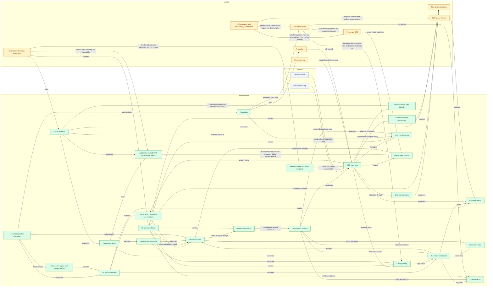

# UI Framework knowledge graph

Generated from knowledge-graph.json. Edit that file and run tools/Update-KnowledgeGraph.ps1. This is a maintained architecture graph; planned nodes describe future work, not implemented APIs.

Green: implemented. Amber: partial. Gray: planned.

## Source index

| Concept | Status | Contract / limitation | Sources |
| --- | --- | --- | --- |
| UI Automation and accessibility acceptance | partial | Core names and native peers support actionable patterns and virtual-row discovery. Host wrappers skip Tab stops. User reports Narrator/scaling acceptance. Scoped palettes follow contrast settings; TextBox uses frozen normal colors and conditional system resources. ThemeStyles batches resource publication with caller-aware initialization ownership. All 146 framework tests pass, including five accessibility acceptance tests and two resource-ownership checks. Discovery setup initializes native UIA on an MTA client while pumping the window dispatcher, then refreshes cached peers; original assertions pass in the full suite and two additional fresh hosts. Latest seven-pair runtime performance passes 32/32; test-only correction does not change that candidate. Physical contrast acceptance remains open and FW-005 separately awaits IME acceptance. FW-006 is not complete. | [UI Framework/View.cs](../UI%20Framework/View.cs), [UI Framework.Wpf/ViewHost.cs](../UI%20Framework.Wpf/ViewHost.cs), [UI Framework.Wpf/Virtualization/VirtualListControl.cs](../UI%20Framework.Wpf/Virtualization/VirtualListControl.cs), [UI Framework.Wpf/Virtualization/VirtualListAutomationPeer.cs](../UI%20Framework.Wpf/Virtualization/VirtualListAutomationPeer.cs), [UI Framework.Wpf/Virtualization/VirtualRowAutomationPeer.cs](../UI%20Framework.Wpf/Virtualization/VirtualRowAutomationPeer.cs), [UI Framework.Wpf/Styling/ThemeStyles.cs](../UI%20Framework.Wpf/Styling/ThemeStyles.cs), [tests/UI Framework.Checks/AccessibilityTests.cs](../tests/UI%20Framework.Checks/AccessibilityTests.cs), [tests/UI Framework.Checks/AccessibilityAcceptanceTests.cs](../tests/UI%20Framework.Checks/AccessibilityAcceptanceTests.cs), [tools/AccessibilityAcceptance/Program.cs](../tools/AccessibilityAcceptance/Program.cs), [tools/AccessibilityAcceptance/AccessibilityAcceptance.csproj](../tools/AccessibilityAcceptance/AccessibilityAcceptance.csproj), [docs/accessibility.md](../docs/accessibility.md), [docs/accessibility-2026-10-26.md](../docs/accessibility-2026-10-26.md), [UI Framework.Wpf/Styling/ThemePalette.cs](../UI%20Framework.Wpf/Styling/ThemePalette.cs), [tests/UI Framework.Checks/ContrastThemeTests.cs](../tests/UI%20Framework.Checks/ContrastThemeTests.cs), [UI Framework.Wpf/Styling/ThemeColor.cs](../UI%20Framework.Wpf/Styling/ThemeColor.cs), [docs/accessibility-2026-10-28.md](../docs/accessibility-2026-10-28.md), [docs/contrast-allocation-investigation-2026-10-28.md](../docs/contrast-allocation-investigation-2026-10-28.md), [UI Framework.Wpf/Styling/TextBoxStyles.cs](../UI%20Framework.Wpf/Styling/TextBoxStyles.cs), [docs/textbox-contrast-2026-10-28.md](../docs/textbox-contrast-2026-10-28.md), [tests/UI Framework.Checks/ThemeResourceUpdateTests.cs](../tests/UI%20Framework.Checks/ThemeResourceUpdateTests.cs), [docs/theme-resource-batching-2026-10-28.md](../docs/theme-resource-batching-2026-10-28.md), [docs/discovery-initialization-2026-10-28.md](../docs/discovery-initialization-2026-10-28.md), [tests/UI Framework.Checks/TestAutomationTree.cs](../tests/UI%20Framework.Checks/TestAutomationTree.cs) |
| Retained native WPF islands | implemented | Core carries an opaque platform description. WPF Interop owns native factories, declared-type identity, updates, detachment, one-time release and an opt-in implicit-style boundary for common native controls. Apps own native contents, local styles and durable state. | [UI Framework/View.cs](../UI%20Framework/View.cs), [UI Framework/ViewKind.cs](../UI%20Framework/ViewKind.cs), [UI Framework.Wpf/Interop/WpfUI.cs](../UI%20Framework.Wpf/Interop/WpfUI.cs), [UI Framework.Wpf/Interop/NativeViewDescriptor.cs](../UI%20Framework.Wpf/Interop/NativeViewDescriptor.cs), [UI Framework.Wpf/Interop/NativeControlHost.cs](../UI%20Framework.Wpf/Interop/NativeControlHost.cs), [UI Framework.Wpf/Interop/NativeStyleScope.cs](../UI%20Framework.Wpf/Interop/NativeStyleScope.cs), [UI Framework.Wpf/Interop/NativeStyleResources.cs](../UI%20Framework.Wpf/Interop/NativeStyleResources.cs), [tests/UI Framework.Checks/NativeHostTests.cs](../tests/UI%20Framework.Checks/NativeHostTests.cs), [tests/UI Framework.Checks/NativeStyleTests.cs](../tests/UI%20Framework.Checks/NativeStyleTests.cs), [docs/native-interop.md](../docs/native-interop.md), [docs/native-style-validation.md](../docs/native-style-validation.md), [samples/Counter/Diagnostics/NativeStyleComparison.cs](../samples/Counter/Diagnostics/NativeStyleComparison.cs), [tools/Test-NativeStyleIsolation.ps1](../tools/Test-NativeStyleIsolation.ps1), [docs/native-island-performance.md](../docs/native-island-performance.md) |
| Text editors, passwords and selectors | implemented | Core describes bound multiline text, masked passwords and indexed pickers. WPF owns native editing, read-only selection, bounded undo, theme integration and feedback suppression. | [UI Framework/UI.cs](../UI%20Framework/UI.cs), [UI Framework/View.cs](../UI%20Framework/View.cs), [UI Framework/ViewKind.cs](../UI%20Framework/ViewKind.cs), [UI Framework.Wpf/Rendering/Node.cs](../UI%20Framework.Wpf/Rendering/Node.cs), [UI Framework.Wpf/ViewHost.cs](../UI%20Framework.Wpf/ViewHost.cs), [UI Framework.Wpf/Styling/ThemeStyles.cs](../UI%20Framework.Wpf/Styling/ThemeStyles.cs), [tests/UI Framework.Checks/EditorTests.cs](../tests/UI%20Framework.Checks/EditorTests.cs), [tests/UI Framework.Checks/CompactInputTests.cs](../tests/UI%20Framework.Checks/CompactInputTests.cs), [tests/UI Framework.Checks/PickerStyleTests.cs](../tests/UI%20Framework.Checks/PickerStyleTests.cs), [UI Framework.Wpf/Styling/PickerStyles.cs](../UI%20Framework.Wpf/Styling/PickerStyles.cs), [docs/editors.md](../docs/editors.md) |
| Responsive layout and scoped styling | implemented | Core defines weighted rows/columns, docking, split panes, adaptive grids, alignment and theme tokens. WPF owns measurement, native splitter input, templates and interaction states. Applications own native content, pane sizing and data templates. Scoped palette updates preserve controls; TextBox shares frozen normal brushes with conditional system-color triggers. Theme resource publication batches invalidations and respects caller-owned initialization. Latest paired validation passes 32/32 performance gates; remaining accessibility acceptance is tracked separately. | [UI Framework/Layout/ViewAlignment.cs](../UI%20Framework/Layout/ViewAlignment.cs), [UI Framework/Styling/ThemeTokens.cs](../UI%20Framework/Styling/ThemeTokens.cs), [UI Framework/Styling/ButtonStyleKind.cs](../UI%20Framework/Styling/ButtonStyleKind.cs), [UI Framework.Wpf/Layout/AdaptivePanel.cs](../UI%20Framework.Wpf/Layout/AdaptivePanel.cs), [UI Framework/Layout/SplitAxis.cs](../UI%20Framework/Layout/SplitAxis.cs), [UI Framework/Layout/SplitPaneLayout.cs](../UI%20Framework/Layout/SplitPaneLayout.cs), [UI Framework.Wpf/Layout/FlexColumnPanel.cs](../UI%20Framework.Wpf/Layout/FlexColumnPanel.cs), [UI Framework.Wpf/Layout/SplitPanePanel.cs](../UI%20Framework.Wpf/Layout/SplitPanePanel.cs), [tests/UI Framework.Checks/WorkspaceLayoutTests.cs](../tests/UI%20Framework.Checks/WorkspaceLayoutTests.cs), [docs/workspace-layout.md](../docs/workspace-layout.md), [UI Framework.Wpf/Styling/ThemeStyles.cs](../UI%20Framework.Wpf/Styling/ThemeStyles.cs), [UI Framework.Wpf/Styling/ButtonContentPresenter.cs](../UI%20Framework.Wpf/Styling/ButtonContentPresenter.cs), [tests/UI Framework.Checks/CompactButtonTests.cs](../tests/UI%20Framework.Checks/CompactButtonTests.cs), [docs/compact-button-validation.md](../docs/compact-button-validation.md), [tests/UI Framework.Checks/ButtonContentTests.cs](../tests/UI%20Framework.Checks/ButtonContentTests.cs), [samples/Counter/Models/LaunchTheme.cs](../samples/Counter/Models/LaunchTheme.cs), [tests/UI Framework.Checks/LayoutStyleTests.cs](../tests/UI%20Framework.Checks/LayoutStyleTests.cs), [UI Framework.Wpf/Styling/ToggleStyles.cs](../UI%20Framework.Wpf/Styling/ToggleStyles.cs), [tests/UI Framework.Checks/ToggleStyleTests.cs](../tests/UI%20Framework.Checks/ToggleStyleTests.cs), [docs/layout-styling.md](../docs/layout-styling.md), [UI Framework.Wpf/Styling/ThemePalette.cs](../UI%20Framework.Wpf/Styling/ThemePalette.cs), [tests/UI Framework.Checks/ContrastThemeTests.cs](../tests/UI%20Framework.Checks/ContrastThemeTests.cs), [UI Framework.Wpf/Styling/ThemeColor.cs](../UI%20Framework.Wpf/Styling/ThemeColor.cs), [docs/accessibility-2026-10-28.md](../docs/accessibility-2026-10-28.md), [docs/contrast-allocation-investigation-2026-10-28.md](../docs/contrast-allocation-investigation-2026-10-28.md), [UI Framework.Wpf/Styling/TextBoxStyles.cs](../UI%20Framework.Wpf/Styling/TextBoxStyles.cs), [docs/textbox-contrast-2026-10-28.md](../docs/textbox-contrast-2026-10-28.md), [tests/UI Framework.Checks/ThemeResourceUpdateTests.cs](../tests/UI%20Framework.Checks/ThemeResourceUpdateTests.cs), [docs/theme-resource-batching-2026-10-28.md](../docs/theme-resource-batching-2026-10-28.md) |
| Launchpad product showcase | implemented | Session-only Overview, Board and Details screens with Back, retained local preferences, edits and workflow actions. Sample models own routes; WPF owns native screen lifetime. | [samples/Counter/Components/Launchpad.cs](../samples/Counter/Components/Launchpad.cs), [samples/Counter/Components/LaunchOverview.cs](../samples/Counter/Components/LaunchOverview.cs), [samples/Counter/Components/LaunchBoard.cs](../samples/Counter/Components/LaunchBoard.cs), [samples/Counter/Components/LaunchDetails.cs](../samples/Counter/Components/LaunchDetails.cs), [samples/Counter/Models/LaunchRoute.cs](../samples/Counter/Models/LaunchRoute.cs), [samples/Counter/Models/LaunchScreen.cs](../samples/Counter/Models/LaunchScreen.cs), [samples/Counter/Diagnostics/LaunchNavigationChecks.cs](../samples/Counter/Diagnostics/LaunchNavigationChecks.cs), [samples/Counter/Models/LaunchModel.cs](../samples/Counter/Models/LaunchModel.cs), [samples/Counter/Models/LaunchItem.cs](../samples/Counter/Models/LaunchItem.cs), [samples/Counter/Models/LaunchStage.cs](../samples/Counter/Models/LaunchStage.cs), [samples/Counter/LaunchpadWindow.cs](../samples/Counter/LaunchpadWindow.cs), [docs/launchpad.md](../docs/launchpad.md) |
| C# composition API | implemented | Text, Button, TextField, TextEditor, PasswordField, Picker, Toggle, Scroll, stacks, modifiers, and Component<T> factories. | [UI Framework/ViewKind.cs](../UI%20Framework/ViewKind.cs), [UI Framework/View.cs](../UI%20Framework/View.cs), [UI Framework/UI.cs](../UI%20Framework/UI.cs), [docs/api-contract.md](../docs/api-contract.md), [tools/Test-ApiCompatibility.ps1](../tools/Test-ApiCompatibility.ps1), [UI Framework/UI Framework.csproj](../UI%20Framework/UI%20Framework.csproj), [UI Framework.Wpf/UI Framework.Wpf.csproj](../UI%20Framework.Wpf/UI%20Framework.Wpf.csproj) |
| View description | implemented | Records describe a view tree without owning native controls. | [UI Framework/ViewKind.cs](../UI%20Framework/ViewKind.cs), [UI Framework/View.cs](../UI%20Framework/View.cs), [UI Framework/UI.cs](../UI%20Framework/UI.cs) |
| Reusable component | implemented | Retained instance with Body, local state, props, and lifetime hooks. | [UI Framework/Component.cs](../UI%20Framework/Component.cs), [docs/components.md](../docs/components.md) |
| Observable state | implemented | Tracks value reads and notifies on unequal assignments. Notifications verify thread ownership and finish delivering to all observers before propagating errors. | [UI Framework/IState.cs](../UI%20Framework/IState.cs), [UI Framework/ObservableState.cs](../UI%20Framework/ObservableState.cs), [UI Framework/State.cs](../UI%20Framework/State.cs), [UI Framework/Dependencies.cs](../UI%20Framework/Dependencies.cs), [UI Framework/ViewSession.cs](../UI%20Framework/ViewSession.cs), [UI Framework/StateNotifications.cs](../UI%20Framework/StateNotifications.cs), [tests/UI Framework.Checks/StateNotificationTests.cs](../tests/UI%20Framework.Checks/StateNotificationTests.cs) |
| Observable list | implemented | Tracks collection reads and structural mutations, not arbitrary item properties. | [UI Framework/StateList.cs](../UI%20Framework/StateList.cs) |
| Dependency session | implemented | Each body/configure build records dependencies and removes stale subscriptions. | [UI Framework/IState.cs](../UI%20Framework/IState.cs), [UI Framework/ObservableState.cs](../UI%20Framework/ObservableState.cs), [UI Framework/State.cs](../UI%20Framework/State.cs), [UI Framework/Dependencies.cs](../UI%20Framework/Dependencies.cs), [UI Framework/ViewSession.cs](../UI%20Framework/ViewSession.cs) |
| WPF view host | implemented | Owns one render session and reconciles descriptions with retained controls. The lifetime wrapper is not a default focus or tab destination; actionable descendants own keyboard focus. Unchanged sibling order patches directly; keyed reconciliation moves a forward-displaced child once when its desired successor is adjacent, avoiding unnecessary detachments of intervening themed/native subtrees. | [UI Framework.Wpf/ViewHost.cs](../UI%20Framework.Wpf/ViewHost.cs), [UI Framework.Wpf/Rendering/Node.cs](../UI%20Framework.Wpf/Rendering/Node.cs), [tests/UI Framework.Checks/PanelReorderTests.cs](../tests/UI%20Framework.Checks/PanelReorderTests.cs), [docs/themed-reconciliation-2026-09-25.md](../docs/themed-reconciliation-2026-09-25.md) |
| Batched dispatcher | implemented | Coalesces invalidations into pending UI-thread renders. | [UI Framework.Wpf/ViewHost.cs](../UI%20Framework.Wpf/ViewHost.cs), [UI Framework.Wpf/Rendering/Node.cs](../UI%20Framework.Wpf/Rendering/Node.cs) |
| Sibling identity | implemented | Parent, key or position, kind, and component type determine reuse. | [UI Framework.Wpf/ViewHost.cs](../UI%20Framework.Wpf/ViewHost.cs), [UI Framework.Wpf/Rendering/Node.cs](../UI%20Framework.Wpf/Rendering/Node.cs), [docs/components.md](../docs/components.md) |
| Mount and cleanup | implemented | Subtree dependencies detach before unmount hooks; removed instances are released. | [UI Framework/Component.cs](../UI%20Framework/Component.cs), [UI Framework.Wpf/ViewHost.cs](../UI%20Framework.Wpf/ViewHost.cs), [UI Framework.Wpf/Rendering/Node.cs](../UI%20Framework.Wpf/Rendering/Node.cs) |
| Native WPF controls | implemented | TextBlock, Button, TextBox, StackPanel, and Border provide Windows UI. | [UI Framework.Wpf/ViewHost.cs](../UI%20Framework.Wpf/ViewHost.cs), [UI Framework.Wpf/Rendering/Node.cs](../UI%20Framework.Wpf/Rendering/Node.cs) |
| Regression checks | implemented | Executable assertions for state, components, identity, lifecycle, and scheduling. | [tests/UI Framework.Checks/FrameworkTests.cs](../tests/UI%20Framework.Checks/FrameworkTests.cs), [tests/UI Framework.Checks/PrimitiveTests.cs](../tests/UI%20Framework.Checks/PrimitiveTests.cs), [tests/UI Framework.Checks/StateSessionTests.cs](../tests/UI%20Framework.Checks/StateSessionTests.cs), [tests/UI Framework.Checks/VirtualizationTests.cs](../tests/UI%20Framework.Checks/VirtualizationTests.cs), [tests/UI Framework.Checks/ComponentChecks.cs](../tests/UI%20Framework.Checks/ComponentChecks.cs), [tests/UI Framework.Checks/Probes/MountMutation.cs](../tests/UI%20Framework.Checks/Probes/MountMutation.cs), [tests/UI Framework.Checks/Probes/OtherProbe.cs](../tests/UI%20Framework.Checks/Probes/OtherProbe.cs), [tests/UI Framework.Checks/Probes/Probe.cs](../tests/UI%20Framework.Checks/Probes/Probe.cs), [tests/UI Framework.Checks/BindingChecks.cs](../tests/UI%20Framework.Checks/BindingChecks.cs), [tests/UI Framework.Checks/Probes/Profile.cs](../tests/UI%20Framework.Checks/Probes/Profile.cs), [tests/UI Framework.Checks/Probes/Preferences.cs](../tests/UI%20Framework.Checks/Probes/Preferences.cs), [tests/UI Framework.Checks/OptimizationChecks.cs](../tests/UI%20Framework.Checks/OptimizationChecks.cs), [tests/UI Framework.Checks/Probes/SelectionProbe.cs](../tests/UI%20Framework.Checks/Probes/SelectionProbe.cs), [tests/UI Framework.Checks/Probes/CallbackProbe.cs](../tests/UI%20Framework.Checks/Probes/CallbackProbe.cs), [tests/UI Framework.Checks/Probes/MemoProbe.cs](../tests/UI%20Framework.Checks/Probes/MemoProbe.cs), [tests/UI Framework.Checks/Probes/Pair.cs](../tests/UI%20Framework.Checks/Probes/Pair.cs) |
| Component demo | implemented | Project board with shared editors, nested checklists, filters, preferences, telemetry, and recursive components. | [samples/Counter/Program.cs](../samples/Counter/Program.cs), [samples/Counter/Components/LabComponent.cs](../samples/Counter/Components/LabComponent.cs), [samples/Counter/Components/Dashboard.cs](../samples/Counter/Components/Dashboard.cs), [samples/Counter/Components/CommandBar.cs](../samples/Counter/Components/CommandBar.cs), [samples/Counter/Components/VisualStressPanel.cs](../samples/Counter/Components/VisualStressPanel.cs), [samples/Counter/Components/SummaryPanel.cs](../samples/Counter/Components/SummaryPanel.cs), [samples/Counter/Components/FilterPanel.cs](../samples/Counter/Components/FilterPanel.cs), [samples/Counter/Components/BoardSlot.cs](../samples/Counter/Components/BoardSlot.cs), [samples/Counter/Components/WorkList.cs](../samples/Counter/Components/WorkList.cs), [samples/Counter/Components/WorkRow.cs](../samples/Counter/Components/WorkRow.cs), [samples/Counter/Components/Inspector.cs](../samples/Counter/Components/Inspector.cs), [samples/Counter/Components/ItemEditor.cs](../samples/Counter/Components/ItemEditor.cs), [samples/Counter/Components/ChecklistPanel.cs](../samples/Counter/Components/ChecklistPanel.cs), [samples/Counter/Components/ChecklistRow.cs](../samples/Counter/Components/ChecklistRow.cs), [samples/Counter/Components/ProjectPanel.cs](../samples/Counter/Components/ProjectPanel.cs), [samples/Counter/Components/TelemetryPanel.cs](../samples/Counter/Components/TelemetryPanel.cs), [samples/Counter/Components/DepthPanel.cs](../samples/Counter/Components/DepthPanel.cs), [samples/Counter/Components/DepthNode.cs](../samples/Counter/Components/DepthNode.cs), [samples/Counter/Components/ActivityPanel.cs](../samples/Counter/Components/ActivityPanel.cs), [samples/Counter/Models/Preferences.cs](../samples/Counter/Models/Preferences.cs), [samples/Counter/Models/ProjectSettings.cs](../samples/Counter/Models/ProjectSettings.cs), [samples/Counter/Models/WorkDetails.cs](../samples/Counter/Models/WorkDetails.cs), [samples/Counter/Models/WorkData.cs](../samples/Counter/Models/WorkData.cs), [samples/Counter/Models/StepData.cs](../samples/Counter/Models/StepData.cs), [samples/Counter/Models/VisualStressState.cs](../samples/Counter/Models/VisualStressState.cs), [samples/Counter/Models/ChecklistItem.cs](../samples/Counter/Models/ChecklistItem.cs), [samples/Counter/Models/WorkItem.cs](../samples/Counter/Models/WorkItem.cs), [samples/Counter/Models/Counters.cs](../samples/Counter/Models/Counters.cs), [samples/Counter/Models/WorkspaceModel.cs](../samples/Counter/Models/WorkspaceModel.cs) |
| Fine-grained updates | partial | Projected observation, local scheduling, and opt-in Memo reduce rebuilds; genuinely broad changes and native layout remain expensive. | [docs/performance.md](../docs/performance.md), [UI Framework/Computed.cs](../UI%20Framework/Computed.cs), [UI Framework.Wpf/ViewHost.cs](../UI%20Framework.Wpf/ViewHost.cs), [UI Framework.Wpf/Rendering/Node.cs](../UI%20Framework.Wpf/Rendering/Node.cs) |
| Focus and IME | partial | The nearest WPF row tracks composition by editor source, since native phase objects change. Focus departure lets WPF finalize native TSF/IMM before detachment; generic providers retain a fallback. Nested editors deactivate before final snapshots. Weak original-focus identity respects newer focus. Routed/native-shape tests and a delayed-action window provide partial evidence; physical IME and accessibility acceptance remain pending. Guarded forward moves require no presenter or descendant composition, focus, mouse capture, pending restoration or completion failure; the check does not change composition ownership. | [README.md](../README.md), [tests/UI Framework.Checks/ComponentChecks.cs](../tests/UI%20Framework.Checks/ComponentChecks.cs), [tests/UI Framework.Checks/Probes/MountMutation.cs](../tests/UI%20Framework.Checks/Probes/MountMutation.cs), [tests/UI Framework.Checks/Probes/OtherProbe.cs](../tests/UI%20Framework.Checks/Probes/OtherProbe.cs), [tests/UI Framework.Checks/Probes/Probe.cs](../tests/UI%20Framework.Checks/Probes/Probe.cs), [UI Framework.Wpf/Virtualization/RowFocusSnapshot.cs](../UI%20Framework.Wpf/Virtualization/RowFocusSnapshot.cs), [tests/UI Framework.Checks/VirtualizationTests.cs](../tests/UI%20Framework.Checks/VirtualizationTests.cs), [UI Framework.Wpf/Rendering/FocusIdentity.cs](../UI%20Framework.Wpf/Rendering/FocusIdentity.cs), [UI Framework.Wpf/Virtualization/VirtualRowPresenter.cs](../UI%20Framework.Wpf/Virtualization/VirtualRowPresenter.cs), [tests/UI Framework.Checks/VirtualizedEditingTests.cs](../tests/UI%20Framework.Checks/VirtualizedEditingTests.cs), [tests/UI Framework.Checks/Probes/TrackedTextComposition.cs](../tests/UI%20Framework.Checks/Probes/TrackedTextComposition.cs), [tools/VirtualizedEditingAcceptance/Program.cs](../tools/VirtualizedEditingAcceptance/Program.cs), [tools/VirtualizedEditingAcceptance/VirtualizedEditingAcceptance.csproj](../tools/VirtualizedEditingAcceptance/VirtualizedEditingAcceptance.csproj), [docs/virtualization.md](../docs/virtualization.md), [docs/virtualized-editing-2026-10-24.md](../docs/virtualized-editing-2026-10-24.md), [tests/UI Framework.Checks/GuardedMoveTests.cs](../tests/UI%20Framework.Checks/GuardedMoveTests.cs) |
| Error recovery | partial | Body and validation failures retain the last tree. Patch failures clear the affected host, finish cleanup and permit explicit rebuild; arbitrary application mutations cannot roll back. | [UI Framework/IState.cs](../UI%20Framework/IState.cs), [UI Framework/ObservableState.cs](../UI%20Framework/ObservableState.cs), [UI Framework/State.cs](../UI%20Framework/State.cs), [UI Framework/Dependencies.cs](../UI%20Framework/Dependencies.cs), [UI Framework/ViewSession.cs](../UI%20Framework/ViewSession.cs), [README.md](../README.md), [UI Framework.Wpf/ViewHost.cs](../UI%20Framework.Wpf/ViewHost.cs), [tests/UI Framework.Checks/RendererFailureTests.cs](../tests/UI%20Framework.Checks/RendererFailureTests.cs), [tests/UI Framework.Checks/ViewValidationTests.cs](../tests/UI%20Framework.Checks/ViewValidationTests.cs), [docs/error-recovery.md](../docs/error-recovery.md) |
| Styling and themes | partial | Basic dimensions, colors, corners, text size, spacing; advanced themes and style systems remain open. | [UI Framework/ViewKind.cs](../UI%20Framework/ViewKind.cs), [UI Framework/View.cs](../UI%20Framework/View.cs), [UI Framework/UI.cs](../UI%20Framework/UI.cs), [UI Framework.Wpf/ViewHost.cs](../UI%20Framework.Wpf/ViewHost.cs), [UI Framework.Wpf/Rendering/Node.cs](../UI%20Framework.Wpf/Rendering/Node.cs), [README.md](../README.md) |
| Navigation | implemented | Core owns observable typed history and entry identity; WPF owns active-screen lifetime and logical snapshots, including nested navigation and virtual rows. | [UI Framework/Navigation/NavigationStack.cs](../UI%20Framework/Navigation/NavigationStack.cs), [UI Framework/Navigation/NavigationEntry.cs](../UI%20Framework/Navigation/NavigationEntry.cs), [UI Framework.Wpf/Navigation/NavigationSurface.cs](../UI%20Framework.Wpf/Navigation/NavigationSurface.cs), [UI Framework.Wpf/Navigation/NavigationSnapshot.cs](../UI%20Framework.Wpf/Navigation/NavigationSnapshot.cs), [UI Framework.Wpf/Rendering/NodeSnapshot.cs](../UI%20Framework.Wpf/Rendering/NodeSnapshot.cs), [UI Framework.Wpf/Virtualization/VirtualListSnapshot.cs](../UI%20Framework.Wpf/Virtualization/VirtualListSnapshot.cs), [tests/UI Framework.Checks/NavigationTests.cs](../tests/UI%20Framework.Checks/NavigationTests.cs), [docs/navigation.md](../docs/navigation.md) |
| List virtualization | partial | WPF owns logical ordering and realization; VirtualRowPresenter owns composition, focus and snapshots. VirtualRowCollection uses row-embedded AVL links, root-verified membership and a mutation-invalidated successor cursor. Removal/disposal sever links. Empty mounts omit the permutation buffer but retain per-row notifications; optional component/focus snapshots share sparse storage. Guarded moves preserve active-editor safeguards. FW-007 is complete locally: 159 tests, 15 visual checks, 21 stress assertions and actual-window validation pass. Seven-pair 10,000-row mounts save 680,216 bytes versus the guard and 22,416 versus phase one; large reorder gains remain. Broad alpha.6 comparison is 31/32 with editor mount +14.74%; a same-binary control and separate 8/8 editor confirmation preserve and contextualize that failure, not erase it. Mixed updates improve 51.04%, allocations 20.09%. Initial-Reset batching was rejected for first-update Gen 1 pauses. Source hashes and archived evidence are verified. Budgets, accepted revision and pending physical IME/contrast acceptance are unchanged. | [UI Framework.Wpf/Virtualization/VirtualListControl.cs](../UI%20Framework.Wpf/Virtualization/VirtualListControl.cs), [UI Framework.Wpf/Virtualization/VirtualListAutomationPeer.cs](../UI%20Framework.Wpf/Virtualization/VirtualListAutomationPeer.cs), [UI Framework.Wpf/Virtualization/VirtualRowAutomationPeer.cs](../UI%20Framework.Wpf/Virtualization/VirtualRowAutomationPeer.cs), [UI Framework.Wpf/Virtualization/VirtualRowPresenter.cs](../UI%20Framework.Wpf/Virtualization/VirtualRowPresenter.cs), [UI Framework.Wpf/Rendering/NodeSnapshot.cs](../UI%20Framework.Wpf/Rendering/NodeSnapshot.cs), [tests/UI Framework.Checks/VirtualizationTests.cs](../tests/UI%20Framework.Checks/VirtualizationTests.cs), [tests/UI Framework.Checks/AccessibilityAcceptanceTests.cs](../tests/UI%20Framework.Checks/AccessibilityAcceptanceTests.cs), [tests/UI Framework.Checks/VirtualizedEditingTests.cs](../tests/UI%20Framework.Checks/VirtualizedEditingTests.cs), [docs/virtualization.md](../docs/virtualization.md), [tools/KeyedShuffleDiagnostics/Program.cs](../tools/KeyedShuffleDiagnostics/Program.cs), [tests/UI Framework.Checks/KeyedReorderTests.cs](../tests/UI%20Framework.Checks/KeyedReorderTests.cs), [tools/Test-KeyedShuffles.ps1](../tools/Test-KeyedShuffles.ps1), [docs/fw007-keyed-shuffles-2026-10-28.md](../docs/fw007-keyed-shuffles-2026-10-28.md), [UI Framework.Wpf/Virtualization/VirtualRowCollection.cs](../UI%20Framework.Wpf/Virtualization/VirtualRowCollection.cs), [UI Framework.Wpf/Virtualization/VirtualRow.cs](../UI%20Framework.Wpf/Virtualization/VirtualRow.cs), [docs/fw007-indexed-shuffles-2026-10-28.md](../docs/fw007-indexed-shuffles-2026-10-28.md), [docs/performance-evidence/2026-10-28-indexed-shuffles/README.md](../docs/performance-evidence/2026-10-28-indexed-shuffles/README.md), [tests/UI Framework.Checks/GuardedMoveTests.cs](../tests/UI%20Framework.Checks/GuardedMoveTests.cs), [docs/fw007-guarded-move-2026-10-28.md](../docs/fw007-guarded-move-2026-10-28.md), [docs/performance-evidence/2026-10-28-guarded-move/README.md](../docs/performance-evidence/2026-10-28-guarded-move/README.md), [UI Framework.Wpf/Virtualization/VirtualRowSavedState.cs](../UI%20Framework.Wpf/Virtualization/VirtualRowSavedState.cs), [docs/fw007-mount-allocations-2026-10-29.md](../docs/fw007-mount-allocations-2026-10-29.md), [docs/performance-evidence/2026-10-29-mount-allocations/README.md](../docs/performance-evidence/2026-10-29-mount-allocations/README.md) |
| Animation | partial | WPF screen entry fade/slide transitions with interruption cleanup and reduced-motion support. General animatable view properties remain planned. | [UI Framework/Navigation/NavigationTransition.cs](../UI%20Framework/Navigation/NavigationTransition.cs), [UI Framework.Wpf/Navigation/NavigationSurface.cs](../UI%20Framework.Wpf/Navigation/NavigationSurface.cs), [docs/navigation.md](../docs/navigation.md) |
| Hot reload tooling | planned | Framework-specific refresh integration and state policies for code updates. | [README.md](../README.md) |
| Other backends | planned | A rendering abstraction and non-Windows implementations. | [README.md](../README.md) |
| Live data binding | implemented | Live direct and record-projected binding with result equality filtering and accepted-value readback. | [UI Framework/Binding.cs](../UI%20Framework/Binding.cs), [docs/bindings.md](../docs/bindings.md), [tests/UI Framework.Checks/BindingChecks.cs](../tests/UI%20Framework.Checks/BindingChecks.cs), [tests/UI Framework.Checks/Probes/Profile.cs](../tests/UI%20Framework.Checks/Probes/Profile.cs), [tests/UI Framework.Checks/Probes/Preferences.cs](../tests/UI%20Framework.Checks/Probes/Preferences.cs) |
| Stress workload | implemented | Full-list, virtualized, themed and editor workloads retain 1000 rows and 50 paired operations. Supplemental 32-island measurements separate retained updates, theme replacement, scope changes and native removal, checking local style precedence and exact release balance. Focused and supplemental runs cannot qualify a release. The editor workload uses the application-owned COM cleanup policy. FW-022 now investigates editor mount phases and host/source initialization order; diagnostic attribution is separate from release gates. FW-007 5fd4a2a passed hosted correctness, packages, graphs and all 32 accepted-baseline checks. Three-pair editor phases and sampled stacks identify repeated native DPI discovery during host-first construction before HwndTarget cache initialization. Source-first removes the sampled fallback; seven untraced pairs measure mount -8.43% and allocation -0.60%, with update time +2.00% and allocation +0.87%. Geometry and 1000 native editors match. Timing remains variable; this does not wholly attribute the historical +14.74% source-version difference. Local 159 tests, 15 visual checks, 21 stress assertions and 8/8 focused editor checks pass. User-authorized source-before-editors-v1 is now the editor benchmark default on both comparison sides; host-first remains an explicit cold diagnostic. Full seven-pair protocol validation passes 30/32 gates: themed mount +13.94% and editor mount +10.97% fail the unchanged 10% budget; these remain preserved local diagnostic failures. The user designated the full exact-commit GitHub Actions run as the performance release gate; hosted validation of the changed protocol is pending. Local evidence remains mandatory; correctness and manual acceptance remain separate. Explicit default/cold phase checks match geometry and 1000 native editors. Framework runtime and accepted baseline are unchanged. | [samples/Counter/StressRunner.cs](../samples/Counter/StressRunner.cs), [samples/Counter/Diagnostics/LayoutEditorComparison.cs](../samples/Counter/Diagnostics/LayoutEditorComparison.cs), [samples/Counter/Diagnostics/Measurement.cs](../samples/Counter/Diagnostics/Measurement.cs), [docs/stress-lab.md](../docs/stress-lab.md), [docs/performance-results.md](../docs/performance-results.md), [docs/performance-guardrails.md](../docs/performance-guardrails.md), [tools/Test-Performance.ps1](../tools/Test-Performance.ps1), [tools/Test-WorkspacePerformance.ps1](../tools/Test-WorkspacePerformance.ps1), [samples/WorkspaceComparison/Program.cs](../samples/WorkspaceComparison/Program.cs), [samples/WorkspaceComparison/LayoutProbe.cs](../samples/WorkspaceComparison/LayoutProbe.cs), [samples/WorkspaceComparison/SubmissionListScenario.cs](../samples/WorkspaceComparison/SubmissionListScenario.cs), [docs/submission-virtualization-2026-09-24.md](../docs/submission-virtualization-2026-09-24.md), [samples/ConsumerDiagnostics/Program.cs](../samples/ConsumerDiagnostics/Program.cs), [samples/ConsumerDiagnostics/FileTreeChecks.cs](../samples/ConsumerDiagnostics/FileTreeChecks.cs), [docs/file-tree-virtualization-2026-09-24.md](../docs/file-tree-virtualization-2026-09-24.md), [tools/Test-ConsumerLayout.ps1](../tools/Test-ConsumerLayout.ps1), [tools/Test-ConsumerPackages.ps1](../tools/Test-ConsumerPackages.ps1), [docs/consumer-package-2026-09-25.md](../docs/consumer-package-2026-09-25.md), [docs/consumer-layout-2026-09-24.md](../docs/consumer-layout-2026-09-24.md), [docs/layout-isolation-2026-09-24.md](../docs/layout-isolation-2026-09-24.md), [docs/editor-timeout-investigation.md](../docs/editor-timeout-investigation.md), [samples/EditorWaitDiagnostics/Program.cs](../samples/EditorWaitDiagnostics/Program.cs), [UI Framework.Wpf/WpfComCleanupPolicy.cs](../UI%20Framework.Wpf/WpfComCleanupPolicy.cs), [tests/UI Framework.Checks/WpfComCleanupPolicyTests.cs](../tests/UI%20Framework.Checks/WpfComCleanupPolicyTests.cs), [samples/ComCleanupLifecycle/Program.cs](../samples/ComCleanupLifecycle/Program.cs), [samples/ComCleanupLifecycle/ComLifetimeProbe.cpp](../samples/ComCleanupLifecycle/ComLifetimeProbe.cpp), [tools/Test-ComCleanupLifecycle.ps1](../tools/Test-ComCleanupLifecycle.ps1), [tools/Test-EditorWaitDiagnostics.ps1](../tools/Test-EditorWaitDiagnostics.ps1), [docs/application-cleanup-policy-2026-09-25.md](../docs/application-cleanup-policy-2026-09-25.md), [tools/performance-baseline.json](../tools/performance-baseline.json), [docs/timing-variance-investigation.md](../docs/timing-variance-investigation.md), [tools/Summarize-PerformancePairs.py](../tools/Summarize-PerformancePairs.py), [scripts/test-performance-pairs.py](../scripts/test-performance-pairs.py), [samples/Counter/Diagnostics/NativeStyleComparison.cs](../samples/Counter/Diagnostics/NativeStyleComparison.cs), [tools/Test-NativeStyleIsolation.ps1](../tools/Test-NativeStyleIsolation.ps1), [docs/native-island-performance.md](../docs/native-island-performance.md), [tools/Test-PresentationContext.ps1](../tools/Test-PresentationContext.ps1), [samples/Counter/Diagnostics/ComparisonPhaseTrace.cs](../samples/Counter/Diagnostics/ComparisonPhaseTrace.cs), [docs/timing-bottleneck-2026-10-24.md](../docs/timing-bottleneck-2026-10-24.md), [samples/Counter/Diagnostics/ComparisonPresentation.cs](../samples/Counter/Diagnostics/ComparisonPresentation.cs), [samples/Counter/Diagnostics/DpiCacheProbe.cs](../samples/Counter/Diagnostics/DpiCacheProbe.cs), [samples/Counter/Diagnostics/CounterStartupCheck.cs](../samples/Counter/Diagnostics/CounterStartupCheck.cs), [samples/Counter/Diagnostics/ComparisonEvents.cs](../samples/Counter/Diagnostics/ComparisonEvents.cs), [tools/Test-WindowStartup.ps1](../tools/Test-WindowStartup.ps1), [tools/Collect-ComparisonTrace.ps1](../tools/Collect-ComparisonTrace.ps1), [tools/Summarize-TimingBottleneck.py](../tools/Summarize-TimingBottleneck.py), [scripts/test-timing-bottleneck.py](../scripts/test-timing-bottleneck.py), [tools/Test-KeyedShuffles.ps1](../tools/Test-KeyedShuffles.ps1), [tools/KeyedShuffleDiagnostics/Program.cs](../tools/KeyedShuffleDiagnostics/Program.cs), [tools/KeyedShuffleDiagnostics/ShuffleRow.cs](../tools/KeyedShuffleDiagnostics/ShuffleRow.cs), [tools/KeyedShuffleDiagnostics/ShuffleCounters.cs](../tools/KeyedShuffleDiagnostics/ShuffleCounters.cs), [docs/fw007-indexed-shuffles-2026-10-28.md](../docs/fw007-indexed-shuffles-2026-10-28.md), [tools/Test-EditorMount.ps1](../tools/Test-EditorMount.ps1), [tools/Summarize-EditorMount.py](../tools/Summarize-EditorMount.py), [scripts/test-editor-mount.py](../scripts/test-editor-mount.py), [docs/editor-mount-investigation-2026-10-29.md](../docs/editor-mount-investigation-2026-10-29.md), [docs/performance-evidence/2026-10-29-editor-mount/README.md](../docs/performance-evidence/2026-10-29-editor-mount/README.md), [docs/performance-evidence/2026-10-29-editor-source-first/README.md](../docs/performance-evidence/2026-10-29-editor-source-first/README.md) |
| Derived observation | implemented | Computed values and State selectors notify only when their results change; subscriptions detach with the last reader. | [UI Framework/Computed.cs](../UI%20Framework/Computed.cs), [UI Framework/Binding.cs](../UI%20Framework/Binding.cs), [docs/performance.md](../docs/performance.md) |
| Component input comparison | implemented | Explicit immutable Memo inputs skip unchanged parent-driven child builds while preserving local updates. | [UI Framework/ViewKind.cs](../UI%20Framework/ViewKind.cs), [UI Framework/View.cs](../UI%20Framework/View.cs), [UI Framework/UI.cs](../UI%20Framework/UI.cs), [UI Framework.Wpf/ViewHost.cs](../UI%20Framework.Wpf/ViewHost.cs), [UI Framework.Wpf/Rendering/Node.cs](../UI%20Framework.Wpf/Rendering/Node.cs), [tests/UI Framework.Checks/OptimizationChecks.cs](../tests/UI%20Framework.Checks/OptimizationChecks.cs), [tests/UI Framework.Checks/Probes/SelectionProbe.cs](../tests/UI%20Framework.Checks/Probes/SelectionProbe.cs), [tests/UI Framework.Checks/Probes/CallbackProbe.cs](../tests/UI%20Framework.Checks/Probes/CallbackProbe.cs), [tests/UI Framework.Checks/Probes/MemoProbe.cs](../tests/UI%20Framework.Checks/Probes/MemoProbe.cs), [tests/UI Framework.Checks/Probes/Pair.cs](../tests/UI%20Framework.Checks/Probes/Pair.cs) |
| Visible stress sequence | implemented | A button runs 60 paced visible UI mutations with action highlighting, progress, and cancellation. | [samples/Counter/Models/Preferences.cs](../samples/Counter/Models/Preferences.cs), [samples/Counter/Models/ProjectSettings.cs](../samples/Counter/Models/ProjectSettings.cs), [samples/Counter/Models/WorkDetails.cs](../samples/Counter/Models/WorkDetails.cs), [samples/Counter/Models/WorkData.cs](../samples/Counter/Models/WorkData.cs), [samples/Counter/Models/StepData.cs](../samples/Counter/Models/StepData.cs), [samples/Counter/Models/VisualStressState.cs](../samples/Counter/Models/VisualStressState.cs), [samples/Counter/Models/ChecklistItem.cs](../samples/Counter/Models/ChecklistItem.cs), [samples/Counter/Models/WorkItem.cs](../samples/Counter/Models/WorkItem.cs), [samples/Counter/Models/Counters.cs](../samples/Counter/Models/Counters.cs), [samples/Counter/Models/WorkspaceModel.cs](../samples/Counter/Models/WorkspaceModel.cs), [samples/Counter/Components/LabComponent.cs](../samples/Counter/Components/LabComponent.cs), [samples/Counter/Components/Dashboard.cs](../samples/Counter/Components/Dashboard.cs), [samples/Counter/Components/CommandBar.cs](../samples/Counter/Components/CommandBar.cs), [samples/Counter/Components/VisualStressPanel.cs](../samples/Counter/Components/VisualStressPanel.cs), [samples/Counter/Components/SummaryPanel.cs](../samples/Counter/Components/SummaryPanel.cs), [samples/Counter/Components/FilterPanel.cs](../samples/Counter/Components/FilterPanel.cs), [samples/Counter/Components/BoardSlot.cs](../samples/Counter/Components/BoardSlot.cs), [samples/Counter/Components/WorkList.cs](../samples/Counter/Components/WorkList.cs), [samples/Counter/Components/WorkRow.cs](../samples/Counter/Components/WorkRow.cs), [samples/Counter/Components/Inspector.cs](../samples/Counter/Components/Inspector.cs), [samples/Counter/Components/ItemEditor.cs](../samples/Counter/Components/ItemEditor.cs), [samples/Counter/Components/ChecklistPanel.cs](../samples/Counter/Components/ChecklistPanel.cs), [samples/Counter/Components/ChecklistRow.cs](../samples/Counter/Components/ChecklistRow.cs), [samples/Counter/Components/ProjectPanel.cs](../samples/Counter/Components/ProjectPanel.cs), [samples/Counter/Components/TelemetryPanel.cs](../samples/Counter/Components/TelemetryPanel.cs), [samples/Counter/Components/DepthPanel.cs](../samples/Counter/Components/DepthPanel.cs), [samples/Counter/Components/DepthNode.cs](../samples/Counter/Components/DepthNode.cs), [samples/Counter/Components/ActivityPanel.cs](../samples/Counter/Components/ActivityPanel.cs), [samples/Counter/VisualStressChecks.cs](../samples/Counter/VisualStressChecks.cs), [docs/stress-lab.md](../docs/stress-lab.md) |
| Experimental release preparation | partial | Alpha.6 libraries and symbols were accepted by NuGet from fd725347749bcee79e29d10ac2a6de4355137be7 after both hosted workflows passed: 146 framework tests and 32 performance gates with unchanged baseline and budgets. Fresh NuGet.org installation passed with isolated caches; both installed DLL hashes match the exact hosted release artifacts. A distinct alpha.6-local.1 Release build for GuidedGrade passed fresh package smoke checks. GitHub Actions is enabled. Physical contrast and IME acceptance remain open; no v1 readiness claim. Raw successful and failed evidence is preserved. | [Directory.Build.props](../Directory.Build.props), [global.json](../global.json), [.github/workflows/validate.yml](../.github/workflows/validate.yml), [tools/Test-Release.ps1](../tools/Test-Release.ps1), [tools/Test-Packages.ps1](../tools/Test-Packages.ps1), [.github/workflows/publish-nuget.yml](../.github/workflows/publish-nuget.yml), [docs/releasing.md](../docs/releasing.md), [CHANGELOG.md](../CHANGELOG.md), [CONTRIBUTING.md](../CONTRIBUTING.md), [LICENSE](../LICENSE), [tools/New-SourceArchive.ps1](../tools/New-SourceArchive.ps1), [tools/Test-Documentation.ps1](../tools/Test-Documentation.ps1), [.github/dependabot.yml](../.github/dependabot.yml), [docs/releases/0.1.0-alpha.5.md](../docs/releases/0.1.0-alpha.5.md), [docs/releases/0.1.0-alpha.6.md](../docs/releases/0.1.0-alpha.6.md) |
| Application-owned WPF presentation startup | implemented | The sample initializes its actual window handle before large ViewHost construction to avoid repeated native process/DPI queries while WPF process caches are unset. ViewHost remains synchronous and creates no window. Benchmarks initialize a short-lived empty presentation target on both revisions, include its cost, and retain the old cold mode diagnostically. | [samples/Counter/Program.cs](../samples/Counter/Program.cs), [samples/Counter/Diagnostics/ComparisonPresentation.cs](../samples/Counter/Diagnostics/ComparisonPresentation.cs), [samples/Counter/Diagnostics/CounterStartupCheck.cs](../samples/Counter/Diagnostics/CounterStartupCheck.cs), [samples/Counter/Diagnostics/DpiCacheProbe.cs](../samples/Counter/Diagnostics/DpiCacheProbe.cs), [tools/Test-WindowStartup.ps1](../tools/Test-WindowStartup.ps1), [tools/Test-Release.ps1](../tools/Test-Release.ps1), [docs/timing-bottleneck-2026-10-24.md](../docs/timing-bottleneck-2026-10-24.md), [docs/performance-guardrails.md](../docs/performance-guardrails.md) |
| Revision-aware repository navigation | implemented | Schema-v2 file navigation adapts curated architecture and XML project references. Bounded queries reconstruct Git revisions with disposable caches. Separate offline history exports connect selected files/concept sources to first-parent commits, highlight file changes and compare revision relationships, preserving deleted nodes and parallel references. Canonical tracked graphs contain no enclosing commit metadata. Protected index hooks and CI enforce outputs; worktree previews include uncommitted sources. Syntax/human evidence is not a semantic call graph. | [scripts/update-knowledge-graph.py](../scripts/update-knowledge-graph.py), [scripts/query-knowledge-graph.py](../scripts/query-knowledge-graph.py), [scripts/export-knowledge-graph-history.py](../scripts/export-knowledge-graph-history.py), [scripts/knowledge-graph-history.js](../scripts/knowledge-graph-history.js), [scripts/test-knowledge-graph-viewer.cjs](../scripts/test-knowledge-graph-viewer.cjs), [scripts/knowledge-graph-agents.md](../scripts/knowledge-graph-agents.md), [scripts/knowledge-graph.html](../scripts/knowledge-graph.html), [scripts/test-knowledge-graph.py](../scripts/test-knowledge-graph.py), [.githooks/pre-commit](../.githooks/pre-commit), [.github/workflows/validate.yml](../.github/workflows/validate.yml), [AGENTS.md](../AGENTS.md), [docs/knowledge-graph/README.md](../docs/knowledge-graph/README.md) |
