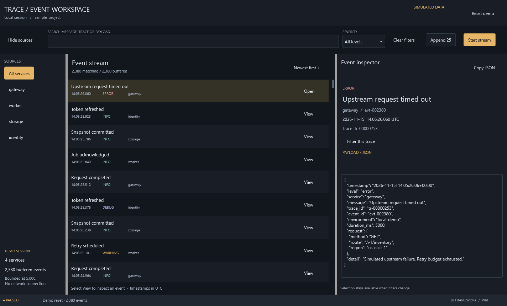

# Trace — multi-pane log viewer



A runnable desktop showcase of UI Framework's existing 1.0.0 contract. Compact
dark styling, native split panes and a virtual stream keep the workflow focused
on finding an event and inspecting its payload. All data is simulated; the
sample does not connect to a server or read your logs.

From the repository root, with the pinned-compatible .NET 10 SDK on Windows:

```powershell
dotnet run --project samples/LogViewer -c Release
```

## Try it

- Search messages, services, trace IDs or JSON fields; combine search with a
  source and severity filter. Clear filters restores the complete buffer.
- Select **View** on a row to retain its payload in the inspector. **Filter this
  trace** finds related events; **Copy JSON** copies the selected payload.
- Drag either splitter, or focus it and use arrow keys. Hide/restore the source
  pane without losing its state. The minimum window size is 1040 × 700 DIP.
- Change chronological order, append 25 events, or start/pause the simulated
  stream (three events every 1.5 seconds). The buffer retains at most 5,000
  events. Selection remains when filters change; eviction selects a remaining
  event. Reset restores the deterministic 2,380-event fixture.

Timestamps are UTC. There is no follow-tail/scroll-to-item API in the shipped
contract; this sample does not promise automatic scroll following. The payload
editor has its own native scroll viewport. Vertical scrollbars use sample-owned
slim dark chrome with a 6-DIP visible thumb and native track/page/drag behavior;
splitter chrome remains Windows-owned. This is a desktop utility, not a mobile layout.

## Ownership

- `Models/` owns observable filter/selection state, immutable events, bounded
  ingestion, deterministic fixture data and the custom `ThemeTokens` palette.
- `Components/` uses only core declarative APIs: `Dock`, `FlexRow`/`FlexColumn`,
  `SplitPane`, `VirtualList`, retained components and bindings. Dynamic rows use
  stable event IDs. Selection lives in the workspace so filtering out a row
  does not discard the selected payload.
- `Hosting/LogWindow.cs` owns the HWND, finite viewport updates, clipboard and
  dispatcher timer and scoped `ScrollChrome.xaml` resources. The timer stops
  while paused and detaches on close.
  `Program.cs` owns the single-STA cleanup policy and application shutdown.
- `Verification/` exercises the actual WPF sample without adding framework APIs
  or templates. Project references intentionally use the checkout's libraries.

## Verify and capture

```powershell
dotnet run --project samples/LogViewer -c Release -- --verify artifacts/log-viewer-review
```

Use a fresh output directory. The check opens an offscreen native window,
exercises filters, empty state, selection, copy delegation, trace filtering,
sort, ingestion/pause, pane collapse, resizing, capacity and timer shutdown.
It saves wide, compact and empty-state PNGs plus `report.json`.
Copy verification uses an injected sink rather than changing your clipboard.

The report retains alternating full-list/virtualized 1,000-row mount diagnostics
with UI-thread allocations and native row counts. These are sample diagnostics,
not before/after framework benchmarks or a performance release gate. Physical
keyboard, screen-reader, high-contrast and IME acceptance remain separate.

## Verified November 15, 2026

The full solution builds warning-free and all 180 framework regression tests
pass with SDK 10.0.402/runtime 10.0.13. The native verification
completed 60 checks, including scrollbar page commands/thumb dragging,
routed keyboard splitter resizing, native Tab
participation, retained editors, clipping checks and timer detachment. Wide,
compact and empty-state renders were inspected; the compact inspector scrolls
its JSON payload. [Compact capture](../../docs/images/log-viewer-compact.png).
The [raw report](../../docs/verification-evidence/2026-11-15-log-viewer/report.json)
retains alternating full-list/virtual mount timings and allocations without
claiming a framework regression comparison. Initial renders exposed clipped
labels; frame heights and font sizes were corrected before these final captures.

Framework runtime, renderer, templates and accepted performance budgets are
unchanged. No hosted performance comparison or physical accessibility campaign
was run for this sample. `tools/Test-Release.ps1` now includes its native checks.
